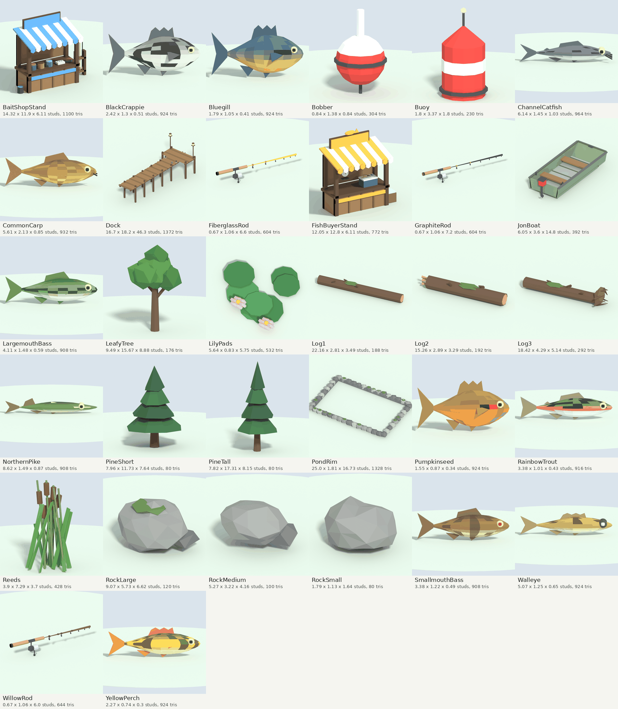
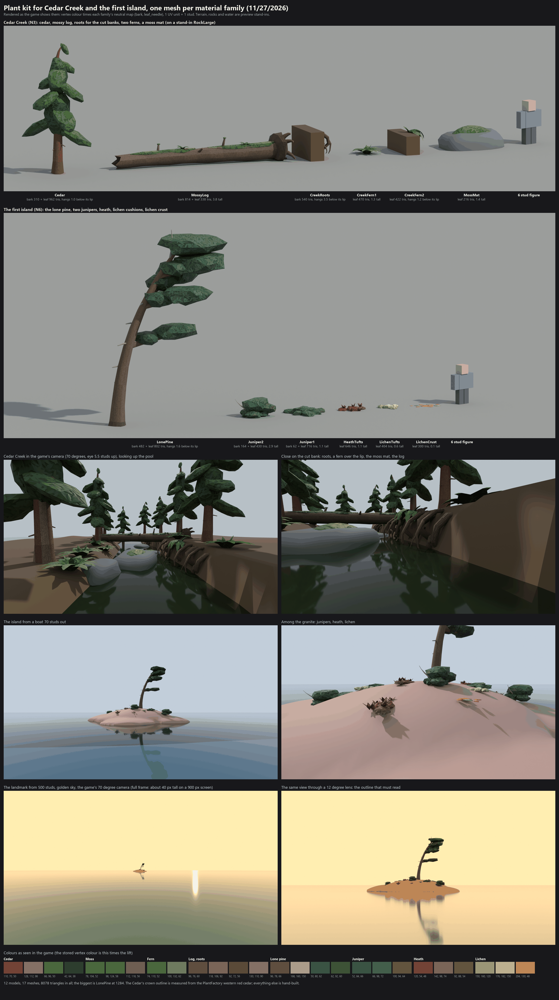
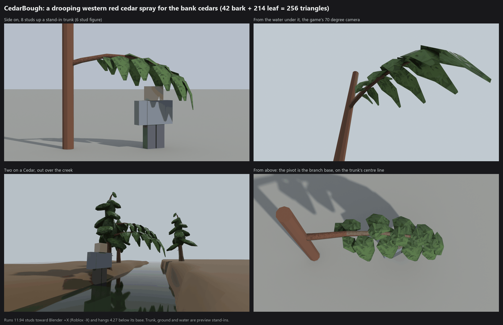
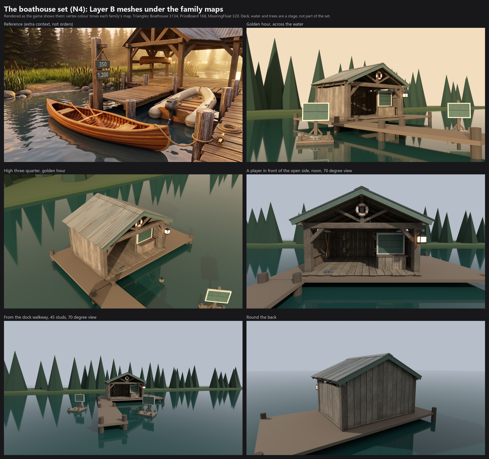
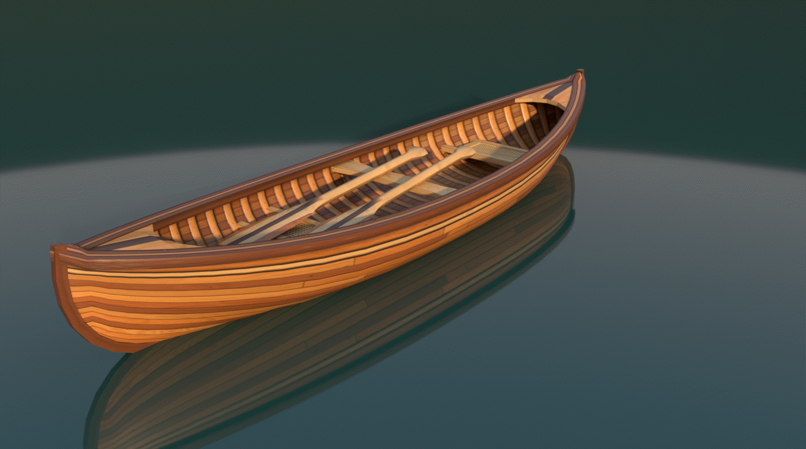
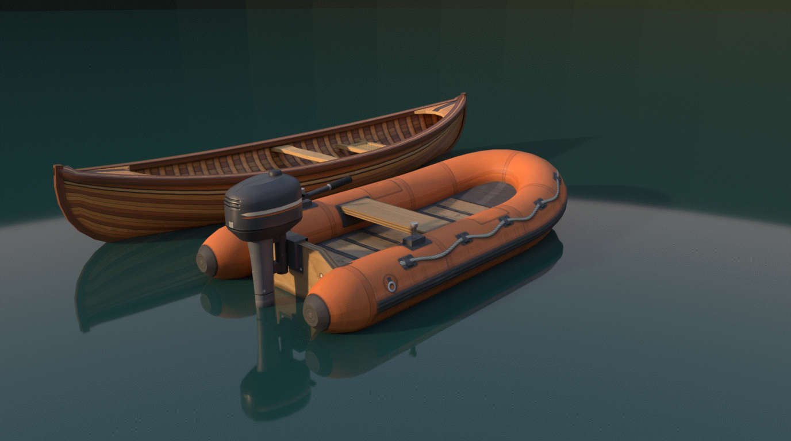

# Art: our own models

Made overnight 2026-11-26 by script in Blender 5.1.2 (the `bpy` module, headless, in the cloud). **Not yet imported or seen in Studio**: tomorrow's session does that. Every model can be rebuilt and tweaked from its script.



## Roblox's import rules (read 2026-11-26)

| Rule | What we do | Source |
|---|---|---|
| At most 20,000 triangles per mesh; meshes should be closed and have some thickness | Every model is one mesh, the biggest about 1,400 triangles; nothing is paper thin (fins and lily pads are thin boxes) | https://create.roblox.com/docs/art/modeling/specifications |
| One material per mesh; textures up to 4096 px, one UV set inside 0 to 1 | No textures at all: each part's flat colour is baked into vertex colours, and all parts are joined into one mesh with one material | https://create.roblox.com/docs/art/modeling/texture-specifications |
| The 3D Importer takes .fbx, .obj and .gltf/.glb, with vertex colours | Each model ships as `.glb` and `.fbx`; try `.glb` first (Roblox's Blender page says glTF needs no extra scaling setup) | https://create.roblox.com/docs/studio/importer and https://create.roblox.com/docs/art/blender |
| 1 stud = 28 cm; in Blender set Unit System to None so 1 Blender unit = 1 stud; FBX export with Apply Scalings = FBX Unit Scale; Importer Scale Unit = Stud | Built in studs with Unit System None; FBX uses FBX Unit Scale, Y up, Z forward | https://create.roblox.com/docs/physics/units and https://create.roblox.com/docs/art/blender |
| Parts can be 0.001 to 2048 studs a side | Biggest is the dock, 46 studs long | https://create.roblox.com/docs/reference/engine/classes/BasePart |
| Collision fidelity: Box, Hull, Default, PreciseConvexDecomposition | See "Importing" below | https://create.roblox.com/docs/parts/meshes |

Unconfirmed: whether Studio shows the baked vertex colours exactly as in the previews (the Importer has an "Ignore Vertex Colors" option, so it reads them; check the first import).

## House style: Real-ish (Stewart's pick, 2026-11-26)

**Leg 3 (11/27/2026):** the full visual direction for Real-ish (the six signatures, the look kit, the palette per area, the checks and budgets) is in `docs/superpowers/plans/2026-11-27-leg-3.md`, section "Visual direction". Where it is more specific than this page, it wins.

Chunky, simple shapes with realistic materials: wood grain on the dock, real grass, sand and stone, clear teal water, natural light. Stewart picked it from the six style options (PR #3, https://github.com/Samizdat-Publications/roblox-fishing-game/pull/3; voting page https://claude.ai/artifact/MJJUZdAHyNqWKE5TdgvX8d). It replaces the flat vertex-colour low-poly look decided earlier the same day. The models already in the game stay until they are re-dressed.

- **Shapes stay simple.** Blender by script (`art/scripts/`) is still the main tool for props, environment, fish, rods and boats. Keep the chunky low-poly shapes: the realism comes from materials and light, not from polygon counts.
- **Desktop first, phones still work.** The game is played mainly on desktop, so the look is aimed at a desktop PC: the best we can get without hitting the PC's performance ceiling. Phones are a second target. They must stay smooth and readable, and they may show a lighter version of the same world. Spend texture memory where the player looks, and save it where they don't.
- **Base layer: Roblox's built-in materials.** Use them for terrain and large repeated surfaces: grass, sand, rock, mud, plank walkways, ground under the islands. They are already physically based and shared by every Roblox game, so they look good and cost almost nothing. The scripts gain a UV step so materials wrap properly on our meshes; check how they map on the first import.
- **Hero layer: custom PBR textures.** A `SurfaceAppearance` (colour, normal, roughness, and metalness where it matters) goes wherever it clearly beats a built-in material: the dock, the stands, the boats, the trophy case, every fish model. Fish are the stars, so they get the best textures. Use shared texture sets per family (one set for all docks, one per fish body type) so quality scales without memory blowing up.
- **Proof corner first, then a budget.** Before the whole world is re-dressed, build one corner of the lake (the dock and the two stands) at full quality, then measure it twice. On Stewart's PC, the target is a steady 60 frames a second at the fixed shots. On phones, the floor is 30 frames a second on Stewart's phone and the smallest phone in the Device Simulator. Those measurements set the texture and draw budget per area.
- **Fallback: Cozy Diorama** (Stewart, 2026-11-26). If the proof corner can't hit those frame budgets after reasonable tuning (the phone tier, texture sizes, shared sets), the house style falls back to Cozy Diorama (`docs/styles/diorama/` in PR #3): rounded toy-like props, felt-like trees, warm light and soft depth of field, which needs far less texture memory. Stewart is told before the switch, with the measurements.
- **A lighter phone tier.** On touch devices a client script turns down the extras: grass and decoration distance, particle density, some post effects, far props. Roblox also lowers graphics quality on its own on weak devices. When the phone floor fails, cut the phone extras first, then textures the player can't see, and only then the desktop look.
- **Built to grow.** The world will get much bigger: a big lake crossed by vehicles, and fishing islands. Each island is its own streaming area with its own texture set (StreamingEnabled, already on by default), so only nearby islands sit in memory.
- **Readability rules.** The bobber and line glow or carry a bright outline so they read against textures and dark water. Keep the grass in the foreground, and put less fine detail where the player looks for bites.
- **Meshy** for complex organic shapes a script can't make well (and a source of textures for hero props). Decimate it in Blender, and match it to the same materials before import.
- **UI icons** (journal fish, bait, rods, boats) are rendered from the same models, so the UI matches the world.
- **PixelLab and CadQuery are not used** for in-game art, to keep one consistent look.

## Conventions

- **Units:** 1 Blender unit = 1 stud. Blender is Z up; the exports are Y up, so the model's height is Roblox Y.
- **Pivot:** bottom centre of each model's bounding box.
- **Look:** chunky, simple shapes with realistic Roblox materials, made for desktop and still readable on a phone (see House style). `scripts/palette.py` still holds the colours for parts that keep a flat colour, such as awnings, bobbers and UI accents.
- **Fish scale:** 1 stud = 12 cm, the same scale the catch on the line uses (`FishingService.showCatch`: length in studs = cm / 12). Each fish is built at its species' average length; scale it by caught cm / average cm. Heads point along +X.

## Rebuild

```
& "C:\Program Files\Blender Foundation\Blender 5.1\blender.exe" -b -P "C:\Users\stewa\Documents\Claude\Roblox\art\scripts\build_all.py"
```

(That's Blender's default install folder; adjust if yours differs. Unverified on Stewart's PC.) One model: the same with `art\scripts\dock.py`; one fish: add `-- Walleye` at the end of the line for `fish.py`. In the cloud it ran as plain Python with `pip install bpy==5.1.2` (plus Pillow for the small previews and the contact sheet). `ART_SAMPLES` sets render quality (48 by default). Each run writes `models/<Name>.glb`, `models/<Name>.fbx`, `previews/<Name>.png` (1024 px) and updates `models/manifest.json` (sizes, triangles, what it replaces). `scripts/contact_sheet.py` rebuilds the sheet.

## Importing (49 done by 2026-11-27)

What works, learned on the first import:

1. **Convert the colours first:** `python art/scripts/roblox_colors.py <Name>` writes `art/models/roblox/<Name>.glb`. Blender exports vertex colours in linear light and Roblox shows them as display colours, so an unconverted model comes in far too dark (the first bluegill was nearly black). Upload the converted copy, never the one in `art/models/`.
2. **Upload through Open Cloud** (Studio MCP `open_cloud_invoke`, `POST /assets/v1/assets`, assetType Model) from `art/models/roblox/`; the repo folder is an approved upload folder. Record the asset id in the table below. Each upload is a permanent asset, so upload once.
3. **Insert it into `ServerStorage.Art`** (`InsertService:LoadAsset(id)` from `execute_luau` in Edit loads many at once, as plain models with their pivot square). Roblox keeps the size exactly (1 stud = 1 Blender unit) and the pivot at the bottom centre, but gives the model a random turn on insert, and **the head or front points along -X in Roblox** (Blender's +X). `PivotTo` an exact CFrame to place it.
4. **Place it from code:** add an entry to `ART` in `src/ServerScriptService/Server/WorldBuilder.luau` (its CFrame and the gray-box parts it hides), then run `WorldBuilder.dress(workspace.Lake)` in Edit. The gray-box parts stay as invisible collision and cast-check shapes; the models are anchored with `CanCollide`, `CanQuery` and `CanTouch` off, so walking, casting, prompts and zones work exactly as before.
5. **Fish** need no placing: a species with a model in `ServerStorage.Art` (named by its id, like `Bluegill`) hangs on the line when caught, stretched to the catch's length (`FishingService` `artFish`).

| Model | Roblox asset id | In the game |
|---|---|---|
| Dock | 92795692386476 | `Lake.Art`, turned 180 degrees so the lamp end is out in the lake; deck top at y = 1.5 |
| BaitShopStand | 128962467669158 | `Lake.Art` at (18, 1, 96.5), open front to the lake |
| FishBuyerStand | 106188034402949 | `Lake.Art` at (-18, 1, 96.5) |
| PondRim | 85562437402898 | `Lake.Art` round the home pond at (50, 1, 106) |
| Log1 | 89531819976790 | Over gray-box logs 1 and 4 |
| Log2 | 99209213624189 | Over gray-box logs 2 and 5 |
| Log3 | 92896234828500 | Over gray-box log 3 |
| Buoy | 101773810678352 | Floating in the deep hole at (0, -0.6, -25) |
| Reeds | 109116103967365 | 18 clumps over the weed bed (replace the weed sticks) |
| LilyPads | 85183031227808 | 7 on the water round the weed bed |
| PineTall | 101345558596198 | On creek trunks 1, 3, 5, 7 |
| PineShort | 93282291561721 | On creek trunks 2, 4, 6, 8 |
| LeafyTree | 98200740872322 | 7 on the lake shore |
| RockLarge | 91170341972863 | Fitted to creek boulders 1, 2, 4 |
| RockMedium | 140479691148163 | Fitted to creek boulders 3, 5 |
| RockSmall | 110035479332491 | Fitted to the 14 creek pebbles |
| Bobber | 138136046417846 | The bobber on every cast (`FishingService` `makeBobber`) |
| WillowRod | 105973286899843 | In ServerStorage only (rods in hand still the gray box) |
| FiberglassRod | 105439165015959 | In ServerStorage only |
| GraphiteRod | 112794029818185 | In ServerStorage only |
| JonBoat | 73308698165043 | In ServerStorage only, for the boat plan |
| Bluegill | 109571493310355 | On the line when one is landed |
| Pumpkinseed | 94171834310429 | On the line when one is landed |
| YellowPerch | 89203301171747 | On the line when one is landed |
| BlackCrappie | 114088207962110 | On the line when one is landed |
| LargemouthBass | 125320665780187 | On the line when one is landed |
| ChannelCatfish | 86511242177797 | On the line when one is landed |
| CommonCarp | 102551350734293 | On the line when one is landed |
| NorthernPike | 87034965888840 | On the line when one is landed |
| RainbowTrout | 118820630960923 | On the line when one is landed |
| SmallmouthBass | 134271966681380 | On the line when one is landed |
| Walleye | 86662257400132 | On the line when one is landed |
| AlbinoCatfish | 136654630727812 | On the line when one is landed |
| Bowfin | 125211984913610 | On the line when one is landed |
| BrookTrout | 76954549921890 | On the line when one is landed |
| BrownTrout | 83259937969236 | On the line when one is landed |
| Burbot | 131253215534131 | On the line when one is landed |
| CreekChub | 102906476073120 | On the line when one is landed |
| FreshwaterDrum | 74501326273593 | On the line when one is landed |
| GoldenTrout | 133626399439261 | On the line when one is landed |
| LakeSturgeon | 76879262373636 | On the line when one is landed |
| LakeTrout | 95668351040749 | On the line when one is landed |
| LakeWhitefish | 102046819647474 | On the line when one is landed |
| Muskellunge | 89397610966749 | On the line when one is landed |
| RockBass | 75104589543512 | On the line when one is landed |
| TigerMuskie | 135170567785055 | On the line when one is landed |
| WhiteBass | 71716066706107 | On the line when one is landed |
| Dinghy | 131459268302795 | In ServerStorage only, for the boat plan |
| DeepV | 136839711681390 | In ServerStorage only, for the boat plan |
| DockHero | 73953474625307 | `ServerStorage.Art.Dock` since 11/27/2026 (leg 3, N0): the hero set, baked colour, normal and roughness as a SurfaceAppearance. The old vertex-coloured dock waits as `Art.DockPlain` for the phone tier |
| BaitShopStand_wood, _canvas, _metal | 113815152721251, 129724187320327, 122388811024576 | `ServerStorage.Art.BaitShopStand` since 11/27/2026: three meshes, WeatheredPlank on wood, Canvas on canvas, stock Metal; the old one waits as `Art.BaitShopStandPlain` |
| FishBuyerStand_wood, _canvas, _metal | 80578305985776, 100378319005593, 120976665888017 | `ServerStorage.Art.FishBuyerStand` since 11/27/2026, as above; the old one is `Art.FishBuyerStandPlain` |
| Bluegill (first try) | 123238298956061 | Not used: uploaded before the colour fix, too dark |
| BirchLean1_bark | 125805882558924 | `ServerStorage.Art` (bank kit, N1) |
| BirchLean1_leaf | 129700640484715 | `ServerStorage.Art` (bank kit, N1) |
| BirchLean2_bark | 138283234746703 | `ServerStorage.Art` (bank kit, N1) |
| BirchLean2_leaf | 79895271357253 | `ServerStorage.Art` (bank kit, N1) |
| Bush1_leaf | 134351210984652 | `ServerStorage.Art` (bank kit, N1) |
| Bush2_leaf | 106907494507711 | `ServerStorage.Art` (bank kit, N1) |
| DriftwoodBranch_bark | 79709164941856 | `ServerStorage.Art` (bank kit, N1) |
| DriftwoodLog_bark | 119920168455068 | `ServerStorage.Art` (bank kit, N1) |
| DriftwoodStump_bark | 140295224704444 | `ServerStorage.Art` (bank kit, N1) |
| Fern1_leaf | 129546014946419 | `ServerStorage.Art` (bank kit, N1) |
| Fern2_leaf | 100002423759617 | `ServerStorage.Art` (bank kit, N1) |
| ReedClump1_leaf | 93789660979767 | `ServerStorage.Art` (bank kit, N1) |
| ReedClump2_leaf | 118810460444914 | `ServerStorage.Art` (bank kit, N1) |
| ShorePine1_bark | 80687642579621 | `ServerStorage.Art` (bank kit, N1) |
| ShorePine1_leaf | 76359460720149 | `ServerStorage.Art` (bank kit, N1) |
| ShorePine2_bark | 112736060544485 | `ServerStorage.Art` (bank kit, N1) |
| ShorePine2_leaf | 72515166122185 | `ServerStorage.Art` (bank kit, N1) |
| ShoreStones1_stone | 117648149300620 | `ServerStorage.Art` (bank kit, N1) |
| ShoreStones2_stone | 136352377294537 | `ServerStorage.Art` (bank kit, N1) |

## The models

The table is generated from `models/manifest.json`. Sizes are studs as X x Y (up) x Z.

| Model | Size (studs) | Triangles | Replaces | Notes |
|---|---|---|---|---|
| [Dock](previews/Dock.png) | 16.7 x 18.2 x 46.3 | 1372 | Workspace.Lake.Dock (Deck, EndDeck, Posts) and the two dock-end lamp posts | Deck top is 9 studs above the model base; place the base at y = -7.5 so the deck top sits at y = 1.5. |
| [FishBuyerStand](previews/FishBuyerStand.png) | 12.05 x 12.8 x 6.11 | 772 | Workspace.Lake.SellStand (Counter, PostL, PostR, Roof); keep the SellPrompt and sign on an invisible counter part | Open front faces the lake. Base sits on the ground (y = 1). |
| [BaitShopStand](previews/BaitShopStand.png) | 14.32 x 11.9 x 6.11 | 1100 | Workspace.Lake.ShopStand (Counter, PostL, PostR, Roof); keep the ShopPrompt and sign on an invisible counter part | Open front faces the lake. Base sits on the ground (y = 1). |
| [PondRim](previews/PondRim.png) | 25.0 x 1.81 x 16.73 | 1328 | Workspace.Lake.HomePond RimN, RimS, RimW, RimE | Centre it on the pond (50, 1, 106 in the gray box); base on the ground. |
| [Log1](previews/Log1.png) | 22.16 x 2.81 x 3.49 | 188 | Workspace.Lake.Logs.Log1 to Log5 (mix the variants) | Lies along X. The gray box sinks logs 0.4 to 1.6 studs; keep that. |
| [Log2](previews/Log2.png) | 15.26 x 2.89 x 3.29 | 192 | Workspace.Lake.Logs.Log1 to Log5 (mix the variants) | Lies along X. The gray box sinks logs 0.4 to 1.6 studs; keep that. |
| [Log3](previews/Log3.png) | 18.42 x 4.29 x 5.14 | 292 | Workspace.Lake.Logs.Log1 to Log5 (mix the variants) | Lies along X. The gray box sinks logs 0.4 to 1.6 studs; keep that. |
| [Buoy](previews/Buoy.png) | 1.8 x 3.37 x 1.8 | 230 | Workspace.Lake.DeepHoleBuoy | Base at the water line minus about 0.6 so it floats. |
| [Reeds](previews/Reeds.png) | 3.9 x 7.29 x 3.7 | 428 | Workspace.Lake.WeedBed Weed sticks (scatter clumps over the weed bed) | Base at the water line; about 7 studs tall. |
| [LilyPads](previews/LilyPads.png) | 5.64 x 0.83 x 5.75 | 532 | Nothing yet: new dressing for the weed bed and pond | Sits on the water surface. |
| [PineTall](previews/PineTall.png) | 7.82 x 17.31 x 8.15 | 80 | Cedar Creek Trunk and Crown pairs | About 16 studs, like the gray box. |
| [PineShort](previews/PineShort.png) | 7.96 x 11.73 x 7.64 | 80 | Cedar Creek Trunk and Crown pairs (mix with PineTall) | About 11 studs. |
| [LeafyTree](previews/LeafyTree.png) | 9.49 x 15.67 x 8.88 | 176 | Nothing yet: new dressing for the lake shore | About 15 studs. |
| [RockSmall](previews/RockSmall.png) | 1.79 x 1.13 x 1.64 | 80 | Cedar Creek Boulder1-5 and Pebble1-14 (pick the size that fits) | About 1.6 studs across. |
| [RockMedium](previews/RockMedium.png) | 5.27 x 3.22 x 4.16 | 100 | Cedar Creek Boulder1-5 and Pebble1-14 (pick the size that fits) | About 4 studs across. |
| [RockLarge](previews/RockLarge.png) | 9.07 x 5.73 x 6.62 | 120 | Cedar Creek Boulder1-5 and Pebble1-14 (pick the size that fits) | About 7 studs across. |
| [Bluegill](previews/Bluegill.png) | 1.79 x 1.05 x 0.41 | 924 | FishShadows blobs and the catch held on the line (FishingService.showCatch) | Built at the species' average length, 18.5 cm = 1.54 studs (1 stud = 12 cm). Scale by caught cm / average cm. Head along +X. |
| [Pumpkinseed](previews/Pumpkinseed.png) | 1.55 x 0.87 x 0.34 | 924 | FishShadows blobs and the catch held on the line (FishingService.showCatch) | Built at the species' average length, 16.0 cm = 1.33 studs (1 stud = 12 cm). Scale by caught cm / average cm. Head along +X. |
| [YellowPerch](previews/YellowPerch.png) | 2.27 x 0.74 x 0.3 | 924 | FishShadows blobs and the catch held on the line (FishingService.showCatch) | Built at the species' average length, 23.5 cm = 1.96 studs (1 stud = 12 cm). Scale by caught cm / average cm. Head along +X. |
| [BlackCrappie](previews/BlackCrappie.png) | 2.42 x 1.3 x 0.51 | 924 | FishShadows blobs and the catch held on the line (FishingService.showCatch) | Built at the species' average length, 25.0 cm = 2.08 studs (1 stud = 12 cm). Scale by caught cm / average cm. Head along +X. |
| [LargemouthBass](previews/LargemouthBass.png) | 4.11 x 1.48 x 0.59 | 908 | FishShadows blobs and the catch held on the line (FishingService.showCatch) | Built at the species' average length, 42.5 cm = 3.54 studs (1 stud = 12 cm). Scale by caught cm / average cm. Head along +X. |
| [ChannelCatfish](previews/ChannelCatfish.png) | 6.14 x 1.45 x 1.03 | 964 | FishShadows blobs and the catch held on the line (FishingService.showCatch) | Built at the species' average length, 62.5 cm = 5.21 studs (1 stud = 12 cm). Scale by caught cm / average cm. Head along +X. |
| [CommonCarp](previews/CommonCarp.png) | 5.61 x 2.13 x 0.85 | 932 | FishShadows blobs and the catch held on the line (FishingService.showCatch) | Built at the species' average length, 57.5 cm = 4.79 studs (1 stud = 12 cm). Scale by caught cm / average cm. Head along +X. |
| [NorthernPike](previews/NorthernPike.png) | 8.62 x 1.49 x 0.87 | 908 | FishShadows blobs and the catch held on the line (FishingService.showCatch) | Built at the species' average length, 77.5 cm = 6.46 studs (1 stud = 12 cm). Scale by caught cm / average cm. Head along +X. |
| [RainbowTrout](previews/RainbowTrout.png) | 3.38 x 1.01 x 0.43 | 916 | FishShadows blobs and the catch held on the line (FishingService.showCatch) | Built at the species' average length, 35.0 cm = 2.92 studs (1 stud = 12 cm). Scale by caught cm / average cm. Head along +X. |
| [SmallmouthBass](previews/SmallmouthBass.png) | 3.38 x 1.22 x 0.49 | 908 | FishShadows blobs and the catch held on the line (FishingService.showCatch) | Built at the species' average length, 35.0 cm = 2.92 studs (1 stud = 12 cm). Scale by caught cm / average cm. Head along +X. |
| [Walleye](previews/Walleye.png) | 5.07 x 1.25 x 0.65 | 924 | FishShadows blobs and the catch held on the line (FishingService.showCatch) | Built at the species' average length, 52.5 cm = 4.38 studs (1 stud = 12 cm). Scale by caught cm / average cm. Head along +X. |
| [Bowfin](previews/Bowfin.png) | 6.28 x 1.36 x 0.85 | 908 | FishShadows blobs and the catch held on the line (FishingService.showCatch) | Built at the species' average length, 65.0 cm = 5.42 studs (1 stud = 12 cm). Scale by caught cm / average cm. Head along +X. |
| [LakeSturgeon](previews/LakeSturgeon.png) | 14.74 x 1.84 x 1.99 | 956 | FishShadows blobs and the catch held on the line (FishingService.showCatch) | Built at the species' average length, 135.0 cm = 11.25 studs (1 stud = 12 cm). Scale by caught cm / average cm. Head along +X. |
| [CreekChub](previews/CreekChub.png) | 1.69 x 0.45 x 0.2 | 908 | FishShadows blobs and the catch held on the line (FishingService.showCatch) | Built at the species' average length, 17.5 cm = 1.46 studs (1 stud = 12 cm). Scale by caught cm / average cm. Head along +X. |
| [RockBass](previews/RockBass.png) | 2.17 x 1.14 x 0.45 | 924 | FishShadows blobs and the catch held on the line (FishingService.showCatch) | Built at the species' average length, 22.5 cm = 1.88 studs (1 stud = 12 cm). Scale by caught cm / average cm. Head along +X. |
| [BrookTrout](previews/BrookTrout.png) | 2.8 x 0.81 x 0.36 | 916 | FishShadows blobs and the catch held on the line (FishingService.showCatch) | Built at the species' average length, 29.0 cm = 2.42 studs (1 stud = 12 cm). Scale by caught cm / average cm. Head along +X. |
| [BrownTrout](previews/BrownTrout.png) | 5.56 x 1.6 x 0.75 | 916 | FishShadows blobs and the catch held on the line (FishingService.showCatch) | Built at the species' average length, 57.5 cm = 4.79 studs (1 stud = 12 cm). Scale by caught cm / average cm. Head along +X. |
| [WhiteBass](previews/WhiteBass.png) | 2.9 x 1.19 x 0.47 | 924 | FishShadows blobs and the catch held on the line (FishingService.showCatch) | Built at the species' average length, 30.0 cm = 2.50 studs (1 stud = 12 cm). Scale by caught cm / average cm. Head along +X. |
| [LakeTrout](previews/LakeTrout.png) | 6.28 x 1.51 x 0.8 | 916 | FishShadows blobs and the catch held on the line (FishingService.showCatch) | Built at the species' average length, 65.0 cm = 5.42 studs (1 stud = 12 cm). Scale by caught cm / average cm. Head along +X. |
| [Muskellunge](previews/Muskellunge.png) | 10.77 x 1.83 x 1.07 | 908 | FishShadows blobs and the catch held on the line (FishingService.showCatch) | Built at the species' average length, 95.0 cm = 7.92 studs (1 stud = 12 cm). Scale by caught cm / average cm. Head along +X. |
| [LakeWhitefish](previews/LakeWhitefish.png) | 3.97 x 1.41 x 0.56 | 916 | FishShadows blobs and the catch held on the line (FishingService.showCatch) | Built at the species' average length, 45.0 cm = 3.75 studs (1 stud = 12 cm). Scale by caught cm / average cm. Head along +X. |
| [FreshwaterDrum](previews/FreshwaterDrum.png) | 4.11 x 1.97 x 0.8 | 924 | FishShadows blobs and the catch held on the line (FishingService.showCatch) | Built at the species' average length, 42.5 cm = 3.54 studs (1 stud = 12 cm). Scale by caught cm / average cm. Head along +X. |
| [Burbot](previews/Burbot.png) | 5.61 x 0.84 x 0.66 | 932 | FishShadows blobs and the catch held on the line (FishingService.showCatch) | Built at the species' average length, 57.5 cm = 4.79 studs (1 stud = 12 cm). Scale by caught cm / average cm. Head along +X. |
| [AlbinoCatfish](previews/AlbinoCatfish.png) | 7.37 x 1.74 x 1.24 | 964 | FishShadows blobs and the catch held on the line (FishingService.showCatch) | Built at the species' average length, 75.0 cm = 6.25 studs (1 stud = 12 cm). Scale by caught cm / average cm. Head along +X. |
| [GoldenTrout](previews/GoldenTrout.png) | 4.11 x 1.23 x 0.52 | 916 | FishShadows blobs and the catch held on the line (FishingService.showCatch) | Built at the species' average length, 42.5 cm = 3.54 studs (1 stud = 12 cm). Scale by caught cm / average cm. Head along +X. |
| [TigerMuskie](previews/TigerMuskie.png) | 12.47 x 2.12 x 1.24 | 908 | FishShadows blobs and the catch held on the line (FishingService.showCatch) | Built at the species' average length, 110.0 cm = 9.17 studs (1 stud = 12 cm). Scale by caught cm / average cm. Head along +X. |
| [WillowRod](previews/WillowRod.png) | 0.67 x 1.06 x 6.0 | 644 | the gray-box rod part from RodService (Willow) | 6.0 studs long along Z, tip toward -Z (as RodService points it). Put the RodTip attachment at the tip. |
| [FiberglassRod](previews/FiberglassRod.png) | 0.67 x 1.06 x 6.6 | 604 | the gray-box rod part from RodService (Fiberglass) | 6.6 studs long along Z, tip toward -Z (as RodService points it). Put the RodTip attachment at the tip. |
| [GraphiteRod](previews/GraphiteRod.png) | 0.67 x 1.06 x 7.2 | 604 | the gray-box rod part from RodService (Graphite) | 7.2 studs long along Z, tip toward -Z (as RodService points it). Put the RodTip attachment at the tip. |
| [Bobber](previews/Bobber.png) | 0.84 x 1.38 x 0.84 | 304 | the ball Bobber and its Top from FishingService.makeBobber | 0.8 studs across like the gray box; the base is the line eye. |
| [JonBoat](previews/JonBoat.png) | 6.05 x 3.6 x 14.8 | 392 | Nothing yet: the boat from the boat plan (gray box in Task 2, this model after) | Hull 14 x 6 studs; floor at about 0.35 studs above the base. Bow toward -Z. |
| [Dinghy](previews/Dinghy.png) | 3.96 x 2.12 x 8.57 | 708 | The gray-box boat BoatService builds (boat plan Task 2) | 8 x 4 stud inflatable; bow toward -Z. Tubes about 1.2 studs high. |
| [DeepV](previews/DeepV.png) | 7.19 x 4.14 x 17.75 | 548 | The gray-box boat BoatService builds (boat plan Task 2) | 16 x 7 stud hull; bow toward -Z. Helm seat behind the console, navigator seat up front. |

Total: 32 models. Every one is a single mesh well under the 20,000 triangle limit; the biggest is the dock at 1372.

## The plant kit: Cedar Creek and the first island (11/27/2026)



Built by `scripts/plant_kit.py` for leg 3, N3 (Cedar Creek) and N6 (the first island). **Uploaded as Model assets 11/27/2026 (all Approved; ids in the Asset id column and `models/plant_kit_ids.json`), not yet seen in Studio.** Same Layer B rules as the home lake bank kit: one mesh per material family, `<Name>_bark` takes the `bark` MaterialVariant and `<Name>_leaf` takes `leaf_needle`, each with its NEUTRAL colour map. UVs are world scale (1 UV unit = 1 stud), and the vertex colours are stored 1.25 times lighter than the colour you should see. Upload the copies in `models/roblox/`. Each mesh has its own entry in `models/manifest.json`, with the palette and placement notes.

**Placing them.** Each model is built with the ground at height 0 and reaches a little below it. The pivot is the bottom centre of the box, so place the pivot at ground height minus `bury` (the table). Two-mesh models, and CreekFern2, have a box centred on the foot of the trunk (or the middle of the log), so both meshes go at the same CFrame and a turn spins the model about its foot. Anything that leans or faces a way was built toward Blender +X, which is **Roblox -X** once imported.

**Where PlantFactory came in.** Stewart's PlantFactory exports (ranch-twin, `assets/plantfactory_export/`) were checked first. Their foliage is alpha-cut leaf cards, which a Layer B mesh (no textures) would show as opaque rectangles, and their trunks are true to scale, far thinner than this game's chunky shapes. So no PlantFactory mesh is shipped. The one real gain is the Cedar's crown: its reach by height and by side is measured from the western red cedar export (Thuja plicata, seed 0), kept in `scripts/plant_envelopes.json` and widened 1.9 times. A real cedar is a narrow column, widest at four tenths of its height, and the Cedar keeps that shape. Ferns, moss, juniper, heather and lichen were never exported, and the lone pine is a deliberately wind-shaped landmark, so those are hand-built. Nothing new had to be exported.

**Budgets.** 12 models, 17 meshes, 8,078 triangles. The island uses 9 of its 12 mesh budget (LonePine, Juniper1 and Juniper2 at two each, then HeathTufts, LichenTufts and LichenCrust). Sizes are the true extent in studs, X x Y (up) x Z.

| Model | Area | Size (studs) | Triangles | Bury | Placement | Asset id |
|---|---|---|---|---|---|---|
| Cedar | Cedar Creek | 8.65 x 19.01 x 8.44 | 310 bark + 962 leaf = 1272 | 1.02 | On the creek banks, 2 studs or more back from the water, in loose groups of two or three so the crowns meet over the stream (the closed canopy). Any turn; scale 0.7 to 1.1 for 13 to 20 studs. The nodding leader at the top leans toward Roblox -X. | bark 89929925085115, leaf 125916479978110 |
| MossyLog | Cedar Creek | 25.81 x 4.11 x 6.41 | 814 bark + 338 leaf = 1152 | 0.27 | Across the pool, each end on a bank top. Lies along X; the root-plate end is at Roblox +X, the broken end at Roblox -X. The ends sink their bury into the banks; the middle may hang over the water. | bark 114696756336675, leaf 91499678123831 |
| CreekRoots | Cedar Creek | 2.7 x 3.53 x 5.6 | 540 bark = 540 | 3.52 | On a cut bank face: the model's Roblox +X side goes into the bank and the roots hang toward Roblox -X (the water). Its ground line is the bank lip, so the pivot goes at lip height minus bury. Roblox terrain is 4 stud voxels, so a cut bank is a slope, not a wall: set the model's back where the slope meets the water line, then check in Studio that the roots are not buried in it. | bark 81523762010950 |
| CreekFern1 | Cedar Creek | 4.08 x 1.48 x 4.15 | 470 leaf = 470 | 0.2 | On the banks and under the cedars, in groups of two to five; any turn, scale 0.8 to 1.3. | leaf 70637352396789 |
| CreekFern2 | Cedar Creek | 3 x 2.02 x 3.64 | 422 leaf = 422 | 1.23 | On the lip of a cut bank or the top of a boulder, the fronds spilling over toward Roblox -X (the water). Its fronds hang 2 studs below its ground line on purpose. | leaf 132778680827228 |
| MossMat | Cedar Creek | 6.93 x 1.83 x 5.28 | 216 leaf = 216 | 0.48 | On the top of a boulder: fitted to RockLarge (scale 1) and RockMedium (scale 0.6). Sink it 0.1 so no gap shows; scale X and Z to fit, Y to match the rock's curve. | leaf 125650230354424 |
| LonePine | Island | 19.47 x 31.17 x 13.42 | 482 bark + 802 leaf = 1284 | 1.56 | The island's landmark: on its highest granite knoll, alone, so the sky is behind it from the approach. The trunk bends and the crown streams toward Roblox -X: turn that away from the prevailing wind (downwind), and so the approach from the marina sees it side on. At scale 1 it stands 29.6 studs and its crown reaches 16 studs downwind of the foot. | bark 91821282189007, leaf 87664113347207 |
| Juniper1 | Island | 6.45 x 1.55 x 5.97 | 62 bark + 716 leaf = 778 | 0.45 | A creeping mat: in the hollows and along the cracks of the granite, any turn, scale 0.7 to 1.3. Sink the rim slightly into rock edges. | bark 94096829561132, leaf 122717726478472 |
| Juniper2 | Island | 6.4 x 3.53 x 3.9 | 164 bark + 430 leaf = 594 | 0.67 | A wind-shorn shrub: on the island's exposed shoulders. It streams toward Roblox -X: turn that downwind, the same way as the LonePine. The bleached dead limb points upwind. | bark 120202751191255, leaf 99359408201006 |
| HeathTufts | Island | 4.66 x 1.23 x 2.81 | 646 leaf = 646 | 0.15 | Between the rocks on any thin soil, drifts of several, any turn. | leaf 77252470532422 |
| LichenTufts | Island | 3.26 x 0.68 x 2.71 | 404 leaf = 404 | 0.1 | Pale reindeer-lichen cushions: on thin soil and in the dips of the granite, near the heath. | leaf 91237021151038 |
| LichenCrust | Island | 4.75 x 0.1 x 3.02 | 300 leaf = 300 | 0.04 | Orange and grey-green crust on the granite itself: lay it on a rock face (tilt it to the slope; it is 0.1 studs thick), mostly on the sunny, bird-perch tops. | leaf 107634350418508 |

**CedarBough (added 11/27/2026, uploaded 11/28/2026: bark 98689591828069, leaf 93142512095077).** 

A drooping western red cedar spray for the bank cedars, to hang out over the stream: 12.31 x 5.4 x 3.97 studs, 42 bark + 214 leaf = 256 triangles, same Layer B rules. It is the one model whose pivot is **not** the bottom centre: the pivot is the branch base (the file's origin), the bough runs 12 studs toward Blender +X (**Roblox -X**) and hangs 4.3 studs below the pivot. Put the pivot on the trunk's centre line, 6 to 10 studs up (times the tree's scale), and turn its -X toward the water: `CFrame.new(base) * CFrame.Angles(0, Scatter.yawMinusX(dx, dz), 0)`, or on a placed Cedar `foot * CFrame.new(0, height, 0)`, since the Cedar's own -X already faces the water. Both meshes share one box and go at the same CFrame. Not yet checked in Studio: whether the importer keeps the file's origin as the pivot (the manifest entry has the offset to set if it does not). Rebuild just this one: `python art/scripts/plant_kit.py --only CedarBough`.

Rebuild: `python art/scripts/plant_kit.py` (the models, the manifest entries and the sheet; `--no-render` for the models only). The previews read the real `bark` and `leaf_needle` maps from `art/textures/` when they are there, or from the folder in `PLANT_KIT_TEXTURES`. To re-measure the cedar from a PlantFactory export: `blender -b -P art/scripts/plant_kit.py -- --measure <file.fbx>`.

## The boathouse set: the dock slips (N4, 11/28/2026)



Built by `scripts/boathouse.py` for leg 3, N4: the Boathouse, the PriceBoard and the MooringFloat. Uploaded 11/28/2026 (ids in `models/boathouse_ids.json`) and composed as `ServerStorage.Art.Boathouse`, `Art.PriceBoard` and `Art.MooringFloat`, pivots at the base centre; not yet placed in the world. They are split by family (Layer B), not baked as one hero texture, because the three families they need already exist: the plank walls and frame wear `WeatheredPlank`, the roof wears `TinRoofRust`, and the boards the game writes on wear `PaintedWood`. That costs no new images, falls back cleanly on the phone tier, and a painted board can be recoloured later without a re-bake. Upload the copies in `models/roblox/`. First pass against final: [Boathouse-before-after.png](previews/Boathouse-before-after.png).

| Mesh | Wears | Size (studs, X x Y x Z) | Triangles |
|---|---|---|---|
| [Boathouse_wood](previews/Boathouse.png) | `WeatheredPlank` (neutral map, colours stored 1.25 times lighter) | 17.95 x 11.38 x 14.7 | 2038 |
| Boathouse_tin | `TinRoofRust` (the colour map, so the vertex colours are near white) | same box | 606 |
| Boathouse_paint | `PaintedWood` (neutral map, 1.25 times lighter) | same box | 326 |
| Boathouse_metal | stock `Metal` (dark iron and galvanised steel in the vertex colours) | same box | 164 |
| [PriceBoard_paint](previews/PriceBoard.png) | `PaintedWood` | 3.28 x 4.72 x 1.6 | 168 |
| [MooringFloat_wood](previews/MooringFloat.png) | `WeatheredPlank` | 4.15 x 1.28 x 4 | 246 |
| MooringFloat_metal | stock `Metal` | same box | 74 |

Boathouse 3,134 triangles of 4,000; PriceBoard 168 of 300; MooringFloat 320 of 400. Seven meshes, no textures of their own.

**Placing.** Every mesh of a set goes at the same CFrame. The pivot is the base centre and the front is Roblox -Z, with no turn needed (built like the stands: Roblox x, y, z is Blender -x, z, y). Each mesh carries two specks at opposite corners of its set's box, so the box and its centre are the same for every mesh of the set. Positions below are in studs from the pivot.

- **Boathouse.** The body is 16 wide by 12 deep to the outer faces of the four corner posts, and the pivot is the centre of that. The tin overhangs it: 8.97 to each side, 7.25 to the front, 6.62 to the back. The ridge is 11.38 up (the brief said about 11), the eaves 7.26, the roof slope 23.7 degrees. The deck top is 0.4 up. The open front is 14.2 wide between the posts and 6.0 clear above the deck under the tie beam.
- **The shop board** (the flat face for the Boats shop's SurfaceGui): 4 wide by 3 tall, centre (-4.5, 4.15, -3.6), facing -Z. It stands behind a low counter at the right-hand front corner (top at 2.46, centre (-4.5, 2.46, -4.16)), where a player in the opening reads it with the camera still outside the roof.
- **The lantern bracket** is on the front right-hand post: a timber arm, an iron hook, cap, cage and base, with no glass. The game's own lantern glass (0.65 x 0.85 x 0.65) and its light go at (-7.55, 4.945, -6.9).
- **The canoe rack** is on the back wall: two uprights with two arms each, so two berths, one above the other, both empty. Arms at x = -2.5 and 4.1 (6.6 apart). A canoe lies along X with its middle at (0.8, 2.4, 3.4) on the lower berth or (0.8, 5.0, 3.4) on the upper (those heights are where the hull rests). Each berth takes a hull up to 13 long, 3.4 wide and 2.0 high at the arms. The rack sits off centre so the shop board hides less of it from the water.
- **PriceBoard.** One mesh, reused for every boat. The flat face for the price is 3 wide by 2 tall, centre (0, 3.1, -0.2), facing -Z. Stand it on a float at the float's (0, 0.78, 1.1).
- **MooringFloat.** The deck top is 0.78 up. Put the pivot 0.35 below the water line so the deck rides 0.43 above the water. The cleat is at the front edge, centre (0, 0.98, -1.25).

**The tin.** The roof is real corrugation, a rib every 0.533 stud, and its UVs run at 2 studs per UV unit so that the `tin_roof` map (15 ribs per tile, 4 studs per tile) lays one rib on each real rib. If the ribs in Studio look doubled, that UV rule is the thing to check. `TinRoof` (the neutral map) also works, for a roof with no brown in its rust.

**Not in the set:** the canoe (its own model), the lantern glass and light, rope (the rope family would be one more mesh), and any lettering. The tie beam over the opening has a clear front face 15 wide by 0.8 tall, centred (0, 6.8, -5.98), for a painted name board.

Rebuild: `python art/scripts/boathouse.py` (models, manifest entries, previews and the two sheets; `--no-render` for the models only; `--views golden,front` for some of the previews). The previews read the real family maps from `art/textures/`.

## The Cedar Canoe: a hero set with its paddle (N4, 11/28/2026)



Built by `scripts/cedar_canoe.py` for leg 3, N4. Uploaded 11/28/2026 (ids in `models/canoe_ids.json`; the maps came in with the GLB as a SurfaceAppearance) and composed in `ServerStorage.Art` as `CedarCanoe`, `CanoePaddle` and the plain twins, material Wood, pivot on the waterline at the origin. A two-seat cedar-strip canoe: varnished strips from honey to red-brown with a thin feature stripe, bent ribs inside, darker hardwood gunwales and stems, small decks at both ends, two cane seats in ash frames and a carrying thwart. It is a hero set (Layer C, like DockHero): the ribs, strips, tacks and cane weave are in the baked maps, the mesh stays simple. Our own design, no maker's marks.

| File | Size (studs, X x Y up x Z) | Triangles | Maps | What it is |
|---|---|---|---|---|
| [CedarCanoe](previews/CedarCanoe.png) | 3.18 x 1.97 x 12.52 | 2,608 | colour, normal, roughness at 1024, embedded | The hull, one mesh, one SurfaceAppearance |
| [CanoePaddle](previews/CanoePaddle.png) | 0.66 x 0.16 x 4.6 | 152 | colour, normal, roughness at 512 x 256, embedded | One paddle, its own mesh, for the avatar's hands |
| [CedarCanoePlain](previews/CedarCanoePlain.png) | 3.18 x 1.96 x 12.5 | 1,224 | none (vertex colours) | The phone tier's twin, as Dock is to DockHero: same lines, pivot and seats, seven real ribs |
| CanoePaddlePlain | 0.66 x 0.16 x 4.6 | 152 | none (vertex colours) | The paddle's plain twin |

Upload the copies in `models/roblox/`. The two hero files are byte for byte the same as in `models/` (no `roblox_colors.py` step); the two plain files have their vertex colours converted. The loose maps are in `textures/cedar_canoe/`, in case the importer does not make the SurfaceAppearance by itself (ColorMap, NormalMap, RoughnessMap; no metalness).

**Placing the canoe.** The file's origin is the **middle of the hull on the waterline**, not the bottom centre, so the pivot goes at the water level. The bow points along **Roblox -Z** and starboard is +X (the model is the same fore and aft, so a half turn only swaps the seats). If the importer puts the pivot on the middle of the box instead, the waterline pivot is 0.763 studs below the middle of the MeshPart (`PivotOffset = CFrame.new(0, -0.763, 0)`). Heights above the pivot:

| What | Roblox position from the pivot (studs) |
|---|---|
| Keel | y = -0.22 (the draft) |
| Lowest point of the inside (bottom boards amidships) | y = +0.22 |
| Bow seat, top centre | (0, 0.64, -2.30); cane 1.45 wide by 0.58 long, frame 1.75 by 0.88 |
| Stern seat, top centre | (0, 0.64, 3.00); cane 1.27 wide by 0.58 long, frame 1.57 by 0.88 |
| Thwart, top centre | (0, 0.87, 0) |
| Gunwale top amidships | y = +1.04 |
| Stem heads | y = +1.75 at z = -6.2 and +6.2 |

**Why it floats high.** Roblox draws the lake inside any hull that dips below the water, so the canoe is drawn as an empty canoe floats (keel 0.22 under) and the inside never comes below 0.22 above the waterline: the bottom is thicker than a real one, which cannot be seen. Keep the bob and the wave size together under about 0.2 studs for this boat, or water will show through the bottom boards. Not yet checked in Studio.

**The paddle.** Its origin is the middle of the **top grip**; the shaft runs 4.6 studs toward Roblox -Z and the blade lies flat (its faces look up and down, Roblox Y). The lower hand holds the shaft about 2.2 studs down, at (0, 0, -2.2). The previews show two lying across the thwart with their blades on the bow seat (`STOW` in the script has the two poses).

**Checked.** No face mirrors its picture (the script counts them), and a back-face render from above, below, both ends and inside shows none, so the files are marked single-sided. Judged against `docs/looks/leg3-references/n4-cedar-canoe-and-boathouse-golden.jpg`: [beside the reference](previews/CedarCanoe-vs-reference.png), [first pass and final](previews/CedarCanoe-before-after.png), [high three-quarter](previews/CedarCanoe-threequarter.png), [at 22 studs](previews/CedarCanoe-ingame.png), [looking in](previews/CedarCanoe-inside.png), [from the water](previews/CedarCanoe-low.png), [the maps](previews/CedarCanoe-atlas.png). It differs from the reference on purpose in three ways: it is longer and slimmer (the plan's 12 by 3 studs), its gunwales are darker than the planking, and it carries no rope.

Rebuild (Windows PowerShell): `cd "C:\Users\stewa\Documents\Claude\Roblox"; & "C:\Program Files\Blender Foundation\Blender 5.1\blender.exe" -b --factory-startup -P "C:\Users\stewa\Documents\Claude\Roblox\art\scripts\cedar_canoe.py"` (models, maps, manifest entries and previews; add `-- --no-render` for the models and maps only, or `-- --views golden,match` for some of the previews). The grain comes from the board scan in `artifacts/textures_src/Planks021/` (see `textures/SOURCES.md`); without it the script draws the grain by noise.

## The Inflatable Dinghy: a hero set with its outboard (N4, 11/28/2026)

Uploaded 11/28/2026 (ids in `models/dinghy_ids.json`; maps embedded in the GLB, imported as a SurfaceAppearance) and composed in `ServerStorage.Art` as `DinghyHero`, `DinghyOutboard`, `DinghyPlain` and `DinghyOutboardPlain`, pivots at the origin. The outboard sits at (0, 1.00, 3.38) from the boat's pivot.



Built by `scripts/dinghy_hero.py` for leg 3, N4. **Not yet uploaded or seen in Studio.** The re-skin of the dinghy that is in the game: the same 8 by 4 stud hull, now two seats. Orange hypalon tubes (base 204,108,48, as `docs/DECISIONS.md` asks) swept in one U with a cone at each stern end and a bow that lifts 0.4; a fabric floor with nine plywood slats; one plywood bench; a plywood transom; two oarlocks; and a small tiller outboard as a mesh of its own. It is a hero set (Layer C, like DockHero and the canoe): the taped seams, the rubbing strake, the grab line and its holders, the D-rings, valves and slats are in the baked maps, and the mesh stays simple. Our own design, no maker's marks. The old vertex-colour `Dinghy` (from `boats.py`) is left as it was.

| File | Size (studs, X x Y up x Z) | Triangles | Maps | What it is |
|---|---|---|---|---|
| [DinghyHero](previews/DinghyHero.png) | 4.0 x 1.52 x 8.0 | 1,886 of 3,000 | colour, normal, roughness at 1024, embedded | The boat, one mesh, one SurfaceAppearance. It carries the outboard's clamp |
| [DinghyOutboard](previews/DinghyOutboard.png) | 0.88 x 3.3 x 2.79 | 568 of 800 | colour, normal, roughness at 512, embedded | The motor, its own mesh, so it can turn, tilt and buzz |
| [DinghyPlain](previews/DinghyPlain.png) | 3.99 x 1.52 x 7.99 | 596 | none (vertex colours) | The phone tier's twin of the boat: same lines, pivot and seats, a charcoal strake and nine real slats |
| DinghyOutboardPlain | 0.88 x 3.3 x 2.79 | 568 | none (vertex colours) | The motor's plain twin, the same mesh |

Upload the copies in `models/roblox/`. The two hero files are byte for byte the same as in `models/` (no `roblox_colors.py` step); the two plain files have their vertex colours converted. The loose maps are in `textures/dinghy/`, in case the importer does not make the SurfaceAppearance by itself (ColorMap, NormalMap, RoughnessMap; no metalness).

**Placing the boat.** The file's origin is the **middle of the hull on the waterline**, as the canoe's is, so the pivot goes at the water level. The bow points along **Roblox -Z** and starboard is +X. If the importer puts the pivot on the middle of the box instead, the waterline pivot is 0.54 studs below the middle of the MeshPart (`PivotOffset = CFrame.new(0, -0.54, 0)`). Positions from the pivot:

| What | Roblox position from the pivot (studs) |
|---|---|
| Keel (the draft) | y = -0.22 |
| Tube bottoms | y = -0.14 |
| Lowest point of the inside (the floor against the transom) | y = +0.27 |
| Driver's seat, at the tiller: bench top centre | (0, 0.80, 0.70); the bench is 0.76 fore and aft, 0.12 thick, 2.28 clear between the tubes |
| Passenger, in the bow: on the floor boards | (0, 0.31, -1.75); about 1.8 wide between the tubes there, and 2.45 studs ahead of the driver |
| Tube tops | y = +0.90 along the sides, rising to +1.30 at the stem |
| Transom top | y = +0.96; its outer face is at z = +3.22 |
| Oarlock tops | (1.45, 1.23, 1.75) and (-1.45, 1.23, 1.75) |
| Outboard pivot (where DinghyOutboard's origin goes) | (0, 1.00, 3.38) |
| Propeller, its middle (spray and wake) | (0, -0.62, 4.13); radius 0.37 |
| Tiller grip end | (-0.21, 1.63, 1.62) |

**The outboard.** Its origin is the top of its swivel column: put it at (0, 1.00, 3.38) from the boat's pivot, with no turn. Steer it about Roblox Y through that point and tilt it about Roblox X; the clamp, its saddle and the two thumb screws are part of the boat, so the motor turns in them. From the outboard's own pivot the propeller is at (0, -1.62, 0.75) and the tiller grip ends at (-0.21, 0.63, -1.76). The cowl top is 2.18 above the water and the skeg reaches 1.12 below it, far deeper than the hull, so tilt the motor up on a beach or in the shallows. With the motor on, the pair is 8.4 studs long (the plate over the propeller ends 0.4 astern of the cones). A dark grey cowl with a cream and an orange pinstripe, a darker pan, a grey alloy leg stained below the water, a three-blade propeller and a rubber twist grip.

**Why it floats high.** Roblox draws the lake inside any hull that dips below the water, so the dinghy is drawn riding light, as the canoe is: the keel 0.22 under, the tubes 0.14, and the floor never below 0.27 above the waterline. The fabric bottom is closed and far thicker than a real one, which cannot be seen. Keep the bob, the trim and the wave size together under about 0.25 studs at the floor, or water will show through the boards. Not yet checked in Studio.

**The seats.** One bench, for the driver. The passenger has room in the bow but no seat of their own (the brief asks for one bench), so the position above is on the floor boards; a perch on top of the bow tube, at the stem, would be at (0, 1.30, -3.45). Sitting poses are the feel layer's job: a stock Roblox sit would put the passenger's legs through the floor.

**Checked.** The hull is 8.0 by 4.0 to the hundredth. No face mirrors its picture (the script counts them), and a back-face render from twelve directions shows none on the boat (a few pixels at the edges of the propeller blades, whose two faces stand 0.006 apart). Judged by eye against `docs/looks/leg3-references/n4-cedar-canoe-and-boathouse-golden.jpg`, whose dinghy is off-white; the plan and `docs/DECISIONS.md` win on colour. No photos of a real boat were used. Sheets: [the old dinghy and this one](previews/DinghyHero-before-after.png), [first pass and final](previews/DinghyHero-first-final.png), [beside the reference](previews/DinghyHero-vs-reference.png). Views: [high three-quarter with the canoe](previews/DinghyHero-threequarter.png), [at 22 studs](previews/DinghyHero-ingame.png), [the driver's camera](previews/DinghyHero-inside.png), [from the water](previews/DinghyHero-low.png), [off the bow](previews/DinghyHero-bow.png), [the reference's framing](previews/DinghyHero-match.png), [the maps](previews/DinghyHero-atlas.png). It differs from the reference on purpose: it is orange, its slats run across the boat (as a real slatted floor does) instead of fore and aft, its tubes are a little slimmer so two avatars fit inside a 4 stud beam, and it carries no oars or coil of rope.

Rebuild (Windows PowerShell): `cd "C:\Users\stewa\Documents\Claude\Roblox"; & "C:\Program Files\Blender Foundation\Blender 5.1\blender.exe" -b --factory-startup -P "C:\Users\stewa\Documents\Claude\Roblox\art\scripts\dinghy_hero.py"` (models, maps, manifest entries and previews, about six minutes; add `-- --no-render` for the models and maps only, or `-- --views golden,inside` for some of the previews). The plywood grain comes from the board scan in `artifacts/textures_src/Planks021/` (see `textures/SOURCES.md`); without it the script draws the grain by noise. The before picture needs `models/Dinghy.glb` and the scale pictures need `models/CedarCanoe.glb`.
