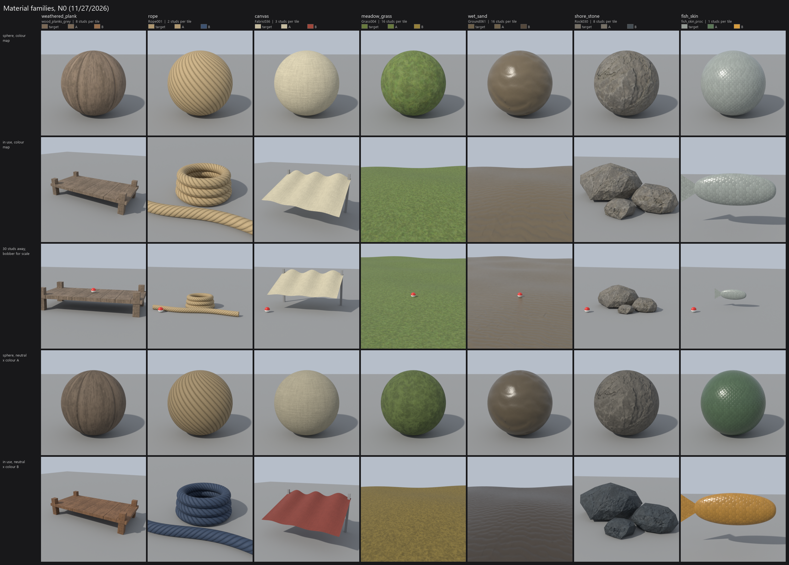
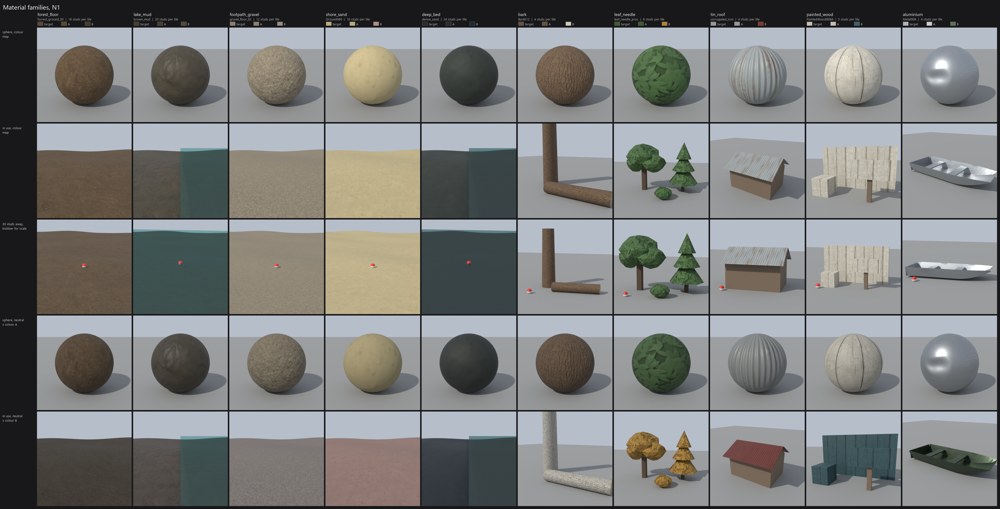

# Material families

The Real-ish material families: the first seven (N0, 11/27/2026) and the next ten (N1, 11/27/2026). Each folder holds the maps for one Roblox `MaterialVariant`. Where each came from is in [SOURCES.md](SOURCES.md). The look is judged on the sheets:





Rows on the sheets: sphere with the colour map; the thing the family is for; the same thing 30 studs away with a bobber for scale; sphere with the neutral map times a sample colour; the thing with the neutral map times a second colour. On the N1 sheet the two lake beds (lake_mud, deep_bed) lie half under a sheet of lake water in row 2 and fully under it in row 3, because that is the only way they are ever seen. The water there is a Blender stand-in, not the engine's.

## Files per family

| File | What it is | Goes in |
|---|---|---|
| `<family>_color.png` | Final colour, pulled to the palette | `ColorMap`, with the part colour white (or a terrain slot with a white tint) |
| `<family>_neutral.png` | Grey copy, mean 0.80 | `ColorMap` on meshes that keep their vertex colours (Layer B), or a terrain slot coloured by its tint |
| `<family>_normal.png` | Normal map, OpenGL | `NormalMap` |
| `<family>_rough.png` | Roughness, white is rough | `RoughnessMap` |
| `<family>_metal.png` | Metalness, white is metal (aluminium only) | `MetalnessMap` |
| `<family>_tile3.jpg` | 3 by 3 tiled preview, colour left and neutral right | Seam check only, do not upload |
| `<family>.json` | Source, settings and measured numbers | Record only |

Use the colour map or the neutral map, not both: the part's colour multiplies whichever one is in `ColorMap`. The neutral map darkens the part's own colour by about a fifth, so pick vertex colours a touch lighter than the colour you want to see.

## Asset ids

Uploads are permanent, so each map goes up once and its id is written here.

| Family | Kind | Size | Studs per tile | Colour id | Normal id | Rough id | Neutral id |
|---|---|---|---|---|---|---|---|
| weathered_plank | prop | 512 | 8 | 137142375088861 | 105890202267685 | 117284029037170 | 80741058595109 |
| rope | prop | 512 | 2 | n/a | 95650373015874 | 105660536950018 | 135935120374206 |
| canvas | prop | 512 | 3 | n/a | 86505477991598 | 124626230291622 | 118947593138172 |
| meadow_grass | terrain | 1024 | 16 | 101241396464400 | 99613738695349 | 138017832448140 | n/a |
| wet_sand | terrain | 1024 | 16 | 135696601239441 | 138574749553165 | 96601916018034 | n/a |
| shore_stone | prop and terrain | 512 | 8 (12 on terrain) | 77321670500551 | 111500464538293 | 80673120127218 | 89874330433856 |
| fish_skin | prop | 512 | 1 | n/a | 81839350043697 | 86528045576678 | 71877620575284 |
| forest_floor | terrain | 1024 | 16 | 95357700780503 | 95747081334473 | 82504253799149 | n/a |
| lake_mud | terrain | 1024 | 20 | 99107177716357 | 98896444647625 | 108288187418156 | n/a |
| footpath_gravel | terrain | 1024 | 12 | 115571706147624 | 102838146211477 | 99044862705199 | n/a |
| shore_sand | terrain | 1024 | 16 | 108907089517955 | 86859007204320 | 132693441658407 | n/a |
| deep_bed | terrain | 1024 | 24 | 110490221392736 | 75840132113757 | 135764485636397 | n/a |
| bark | prop | 512 | 4 | n/a | 75468619984383 | 116447292242793 | 131285884539566 |
| leaf_needle | prop | 512 | 8 | n/a | 106977982508439 | 101588155137944 | 77632184387333 |
| tin_roof | prop | 512 | 4 | 123504692013472 | 114659436037341 | 96342230031415 | 130249019931486 |
| painted_wood | prop | 512 | 5 | n/a | 138548088880298 | 114031226403634 | 125197895604357 |
| aluminium | prop | 512 | 4 | n/a | 140540589693552 | 130928792762580 | 116945538976167 |

aluminium also has a metalness map. Metal id: (not uploaded yet).

n/a means that map was not uploaded (not needed for that family). An empty cell means not uploaded yet (the ten N1 families, made 11/27/2026). Colour id is the palette colour map; rope, canvas and fish_skin use the neutral map only. Machine-readable copy: `ids.json`.

## N1 families: base material and which map to use

| Family | Roblox base material | Map to put in `ColorMap` | Mean colour of the colour map |
|---|---|---|---|
| forest_floor | `LeafyGrass` (terrain) | colour, white slot tint | 92,72,48 |
| lake_mud | `Mud` (terrain) | colour, white slot tint | 70,62,46 |
| footpath_gravel | `Ground` (terrain) | colour, white slot tint | 140,128,108 |
| shore_sand | `Sand` (terrain) | colour, white slot tint | 186,170,128 |
| deep_bed | `Mud` (terrain) | colour, white slot tint | 40,46,40 |
| bark | `Wood` | neutral, hue from the mesh | 104,82,62 |
| leaf_needle | `LeafyGrass` | neutral, hue from the mesh | 62,92,48 |
| tin_roof | `CorrodedMetal` | colour for bare galvanised tin (the rust is brown only there); neutral for painted roofs | 150,152,150 |
| painted_wood | `WoodPlanks` | neutral, the mesh colour is the paint | 196,190,176 |
| aluminium | `Metal` | neutral, with a pale mesh colour (about 200,204,208) | 176,180,184 |

The terrain base materials are picked for the footstep sound and so that no slot fights another: wet_sand and shore_sand share `Sand`, lake_mud and deep_bed share `Mud`, each in its own slot, the way wet_sand already sits in slot 23. None of them uses `Grass`, so no grass blades grow on them.

## Notes for whoever applies them

- **Studs per tile** are starting values from the sheet, where one unit is one stud. weathered_plank at 8 gives boards about 1.3 studs wide. fish_skin at 1 gives scales about a sixth of a stud; go to 0.75 for small fish if the scales look too big on them.
- **weathered_plank**: the boards run along the map's V direction. On a flat part check which way they run and turn the part or use `MaterialPattern` if they run the wrong way.
- **fish_skin**: the free edge of each scale points toward the map's -U. Family materials are box-mapped on meshes, so check the first fish in Studio to see which way the scales lie.
- **meadow_grass**: the colour map's mean is exactly 104,122,62 with little hue variation, so grass blades that take their colour from it come out the meadow green. For autumn, use the neutral map with the slot tint.
- **wet_sand**: roughness 0.35 is what makes it read as wet. If it glares at noon, raise it with `python art/scripts/texture_pipeline.py wet_sand --set rough_mean=0.45`.
- The mean colour of every colour map is its palette target to within one step of 255. The neutral maps are pure grey with a mean of 0.80.
- **forest_floor**: pine needles on brown soil. At 16 studs per tile the needles read from 3 to about 12 studs and it is a calm brown beyond that. Paint it under the trees and let it meet meadow_grass along a wandering edge.
- **lake_mud** and **deep_bed**: made calm on purpose (brightness variation about 6 and 3 percent) and tiled large (20 and 24 studs), because they are only seen through water and anything busy would shimmer under the waves. lake_mud is for the bed down to about 6 studs, deep_bed below that. Roughness 0.6 and 0.7, so no glare if a bank ever shows them dry.
- **footpath_gravel**: fine gravel with dirt between the stones. If the path looks too clean next to the grass, drop to 10 studs per tile before touching the map.
- **shore_sand**: dry sand, 186,170,128, with soft pock marks. It is the pale partner of wet_sand: wet_sand at the waterline, shore_sand above it.
- **bark**: deep furrows running along the map's V direction. On a trunk V must run up the trunk, on a log along it. The pale sample on the sheet (206,200,188) is a stand-in for birch: it reads as a pale furrowed trunk, not as birch, until the mesh carries birch's dark bands in its vertex colours.
- **leaf_needle**: sprays of soft leaf shapes in three depths, made by code. One leaf is about 0.8 stud long at 8 studs per tile, which holds up from 10 to 60 studs on a low-poly canopy. Use 5 or 6 for bushes, reeds and undergrowth. It is one map for leaves and needles: on a pine it reads as soft foliage, not as needles.
- **tin_roof**: seven ribs per tile, so a rib every 0.57 stud at 4 studs per tile (wider than real tin, so it does not shimmer at distance). The ribs run along V: V must run down the roof slope. The colour map has brown rust runs; the neutral map can only show them as darker runs, so a painted roof gets worn streaks instead of rust.
- **painted_wood**: four boards per tile running along V, 1.25 studs wide at 5 studs per tile, with a dark groove between boards and the paint worn thin beside the grooves. The wear shows as a darker, rougher band with the grain in it, since a neutral map cannot change hue.
- **aluminium**: brushed lines run along U. `aluminium_metal.png` is the metalness map (mean 0.90, a touch lower where the surface is rougher); roughness mean 0.42. A few shallow dents are in the normal map. Metal takes its look from what it reflects, so judge it in Studio under the real sky, not on the sheet.

## Rebuild

```powershell
cd "C:\Users\stewa\Documents\Claude\Roblox"; python art\scripts\texture_pipeline.py --all --fetch; python art\scripts\material_sheet.py; python art\scripts\material_sheet.py --sheet n1
```

One family: `python art\scripts\texture_pipeline.py weathered_plank`. Try another source: `python art\scripts\texture_pipeline.py --candidates weathered_plank` (writes to `artifacts\textures_candidates\`). Add a family: add it to `art\scripts\texture_families.json` (source, size, target colour, studs per tile, and `"sheet": "n1"` to put it on the N1 sheet) and run it. The sheet needs Blender 5.1 at its default install path, or set the `BLENDER` environment variable.
