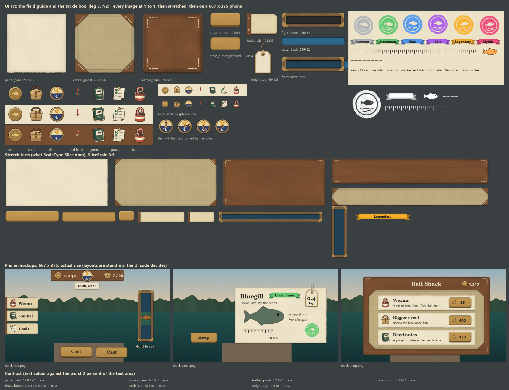

# UI art: the field guide and the tackle box

Leg 3, N2. Drawn by `art/scripts/ui_art.py` (Pillow, numpy, scipy), 11/27/2026. Not yet uploaded or seen in Studio. Rebuild everything, this page included:

```powershell
cd "C:\Users\stewa\Documents\Claude\Roblox"; python "C:\Users\stewa\Documents\Claude\Roblox\art\scripts\ui_art.py"
```



Phone mockups at the real 667 x 375 size are in `preview/` (`mock_hud.png`, `mock_catch.png`, `mock_shop.png`). They are layouts to judge the art by, not the final UI.

## The images

SliceCenter is `Rect.new(left, top, right, bottom)` in image pixels. All PNGs have alpha, with the colour bled into the clear pixels so Roblox shows no dark fringe.

| File | Size | SliceCenter (left, top, right, bottom) | Use | Tint | Asset id |
|---|---|---|---|---|---|
| `paper_card.png` | 256 x 256 | 24, 24, 232, 232 | Anything you read: the catch card plate, journal pages, goal list, toasts. Ink text. The paper edge sits 9 px in (top 7, bottom 12): the rest of the margin is the shadow. | no | 111952873635447 |
| `canvas_panel.png` | 256 x 256 | 72, 72, 184, 184 | Shop and tackle box inner panels, list backgrounds. Ink text. Leather corners 56 px; hem 12 px. | no | 100647632577482 |
| `leather_panel.png` | 256 x 256 | 76, 76, 180, 180 | The shop and tackle box frame, HUD strap. Paper-colour text (236,226,200). Stitches turn each corner; the straight runs carry a creased line. | no | 82829022242054 |
| `brass_button.png` | 128 x 64 | 16, 16, 112, 44 | Buttons, key caps, price tags. Ink text, centred on the face (the face is rows 3 to 53; the lip and shadow are below it). | no | 76498368525806 |
| `brass_button_pressed.png` | 128 x 64 | 16, 16, 112, 44 | The same button held down: swap the image and move the label down 4 px x SliceScale. | no | 74847028651282 |
| `tackle_tab.png` | 128 x 96 | 36, 0, 100, 96 | The side buttons as tabs on the box edge (left side of the screen). Stretch sideways only: set SliceScale = height / 96. Ink text and icon from x = 22 x SliceScale. | no | 113006756128385 |
| `fight_frame.png` | 256 x 64 | 30, 26, 226, 36 | Wood and brass frame for the fight bar; works upright or lying down without rotating. The window is see-through: put it over the track. Rail 13 px; the window is x 16 to 240, y 15 to 46. | no | 134599207241882 |
| `water_track.png` | 256 x 32 | 10, 10, 246, 22 | The fight bar track, under the frame. Zone and marker go on top. | no | 134261839209912 |
| `fish_marker.png` | 64 x 32 | none | The fight bar marker (head to the right; Rotation for upright bars). White with a darker rim of the same tint. | yes | 98969018068113 |
| `rarity_seal.png` | 128 x 128 | none | The rarity stamp on the catch card and journal. Tint with the rarity colour; a few degrees of Rotation looks stamped. | yes | 134835721672003 |
| `rarity_ribbon.png` | 128 x 32 | 28, 0, 100, 32 | A ribbon in the rarity colour, the rarity name on it. Stretch sideways only: SliceScale = height / 32. | yes | 138362753541854 |
| `weight_tag.png` | 96 x 128 | none | The hanging weight tag on the catch card. Ink text inside x 21 to 75, y 56 to 116. The string runs off the top: hang it from the card's top edge. | no | 111653429100454 |
| `icon_coin.png` | 64 x 64 | none | HUD coin, prices. | no | 123661913060053 |
| `icon_creel.png` | 64 x 64 | none | HUD bag (the creel). | no | 114872319828894 |
| `icon_dial.png` | 64 x 64 | none | HUD time dial: day on top (noon is straight up), night below. The code turns a hand about the centre. | no | 73280041727054 |
| `icon_dial_hand.png` | 64 x 64 | none | The dial's hand, pointing up (noon). Same size and centre as the dial: lay it over and set Rotation. | no | 112560754686750 |
| `icon_journal.png` | 64 x 64 | none | Journal tab. | no | 72617922683670 |
| `icon_goals.png` | 64 x 64 | none | Goals tab. | no | 97549842099129 |
| `icon_bait.png` | 64 x 64 | none | Bait tab. | no | 125159545207312 |
| `ruler_strip.png` | 256 x 32 | none | The ruled length line on the catch card. White: set ImageColor3 to ink (38,34,30). Tiles every 256 px (ScaleType Tile); long tick every 32 px, short every 8. | yes | 131872386818289 |
| `stitch_strip.png` | 64 x 12 | none | Extra: a tiling stitch line (ScaleType Tile, TileSize 64 x 12) for a full stitched border where wanted. Tint with thread (230,214,172). | yes | 126422119016991 |

## Notes for the UI code

- **SliceScale.** The panels are drawn chunky so they can be shown small. On a 667 x 375 phone the mockups use SliceScale 0.5 for the three panels (0.4 for small paper rows, 0.3 for the HUD strap) and about 0.7 for buttons and the fight frame.
- **Nothing repeats in a stretch zone.** Stitches and corner pieces sit in the corners; the stretched middles carry only flat texture and continuous lines. For stitches all the way round, tile `stitch_strip.png` along the edge.
- **Shadows are inside the images.** Panels, buttons, the tab and the tag carry their own soft shadow in the alpha, so no extra shadow frames are needed. Lay content out from the SliceCenter, not the image edge.
- **Tintable images are white.** Set `ImageColor3`. The ruler needs ink (38,34,30); left white it will not show on paper.
- **Colours used.** Paper 236,226,200. Ink 38,34,30. Brass 176,136,72. Canvas 188,170,126. Leather 120,78,48. Thread 230,214,172. Wood 122,92,62. Water 44,104,140. Manila (tab) 228,212,172.

## Contrast, measured

Text colour against the worst 2 percent of pixels where the text goes (the phone rule is 4.5 to 1).

| Surface | Text colour | Contrast | 4.5 to 1 |
|---|---|---|---|
| `paper_card.png` | 38,34,30 | 12.0 to 1 | pass |
| `canvas_panel.png` | 38,34,30 | 6.5 to 1 | pass |
| `leather_panel.png` | 236,226,200 | 5.2 to 1 | pass |
| `brass_button.png` | 38,34,30 | 5.1 to 1 | pass |
| `brass_button_pressed.png` | 38,34,30 | 5.0 to 1 | pass |
| `tackle_tab.png` | 38,34,30 | 10.1 to 1 | pass |
| `weight_tag.png` | 38,34,30 | 11.5 to 1 | pass |

Rarity colours are unchanged. They were picked for dark panels, so on paper they are pale:

| Rarity | Colour | Ink text on the ribbon | Seal against paper |
|---|---|---|---|
| Common | 175,180,185 | 7.6 to 1 | 1.6 to 1 |
| Uncommon | 95,200,110 | 7.5 to 1 | 1.6 to 1 |
| Rare | 80,150,240 | 5.2 to 1 | 2.3 to 1 |
| Epic | 170,95,235 | 4.2 to 1 | 2.9 to 1 |
| Legendary | 250,175,40 | 8.4 to 1 | 1.4 to 1 |
| Mythic | 240,75,125 | 4.5 to 1 | 2.7 to 1 |

So: the rarity name goes in ink on the ribbon (Epic is the weakest; keep that label bold and at least 19 px, or set it beside the ribbon in ink), and the seal is a mark of colour, not something to read. It never carries the only copy of the rarity.
