# Fishing Game: the making of

A Roblox fishing game where real fishing knowledge matters: the right bait, spot and time of day decide what bites.

Newest first. The live page with before and after sliders is `docs/making-of/index.html` (published as a Claude artifact).

## Art: The whole lake in our own models

2026-11-26 16:30 · commit `f883e07`

The rest of the art is in: a Fish Buyer stand, a stone rim for the home pond, mossy logs half sunk in the water, a red and white buoy over the deep hole, reed clumps and lily pads in the weed bed, leafy trees round the lake, pines and rocks along Cedar Creek, a new bobber, and every fish hangs on the line as itself. While checking, the whole lake turned out to have been knocked 55 studs sideways and 10 up in Studio, away from its own water; it is back in place. Walking, casting, selling and the pond all work as before.

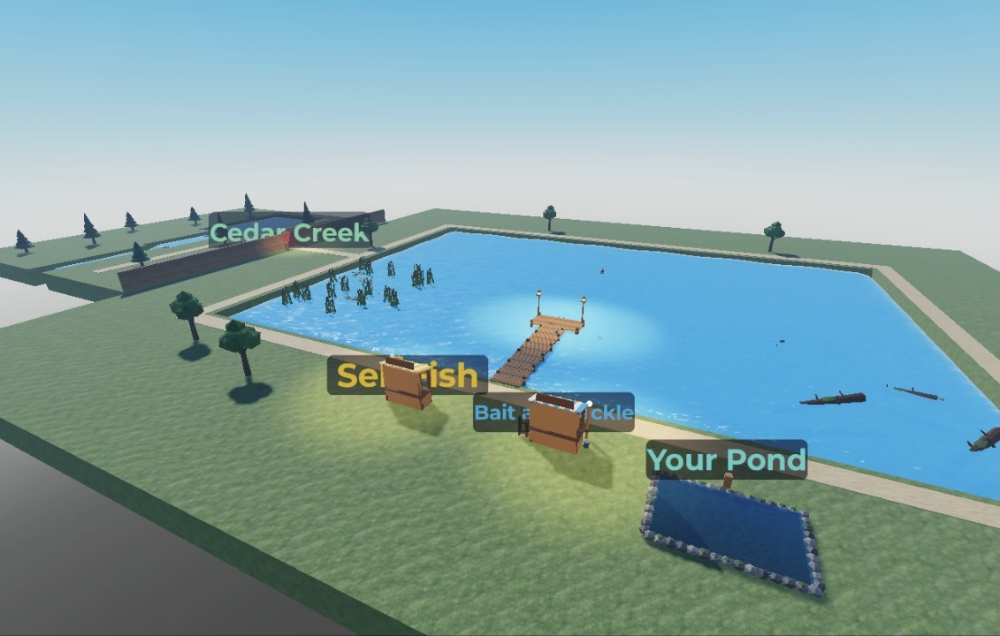
*The lake with every model in*

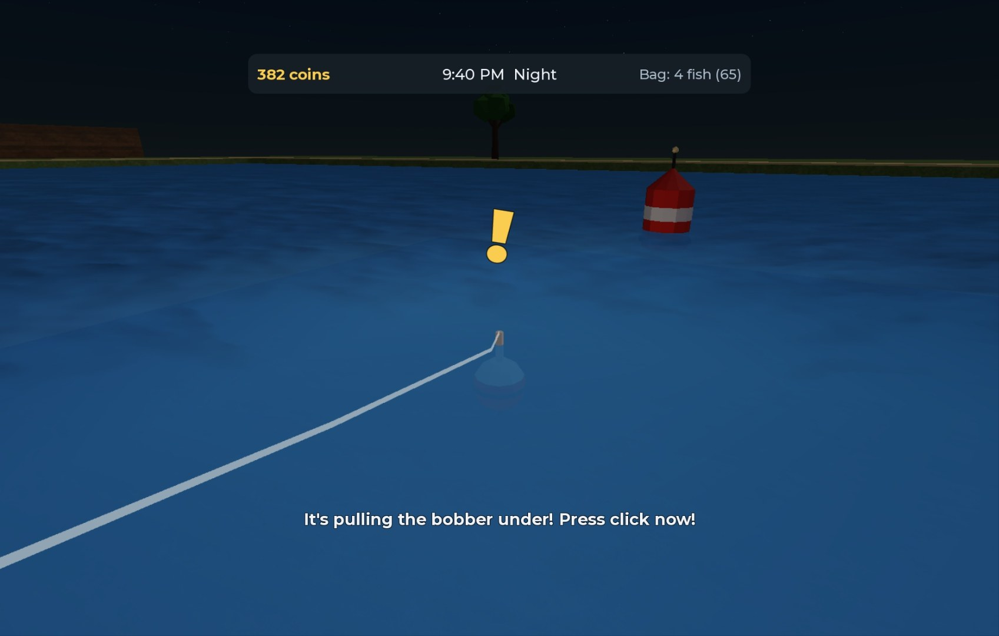
*Night at the deep hole: a catfish pulls the new bobber under, the new buoy behind*

*Pines and rocks along Cedar Creek*

*Mossy logs in the east shallows*

## Art: Our first models in the game

2026-11-26 13:30 · commit `c4041a7`

The dock, the Bait and Tackle stand and the bluegill, built by script in Blender, are now in the game. The dock has planks, posts, bollards and two lanterns at the far end; the shop has a striped awning, bait tubs and a rod rack. A landed bluegill now hangs on the line as the real fish. The first import came in nearly black because Blender and Roblox store colours differently, so a small converter now fixes every model before upload. Everything still walks, casts and shops exactly as before, because the old gray blocks stay underneath as invisible floors and walls.

**The dock, gray box and model**

| Before | After |
|---|---|
| 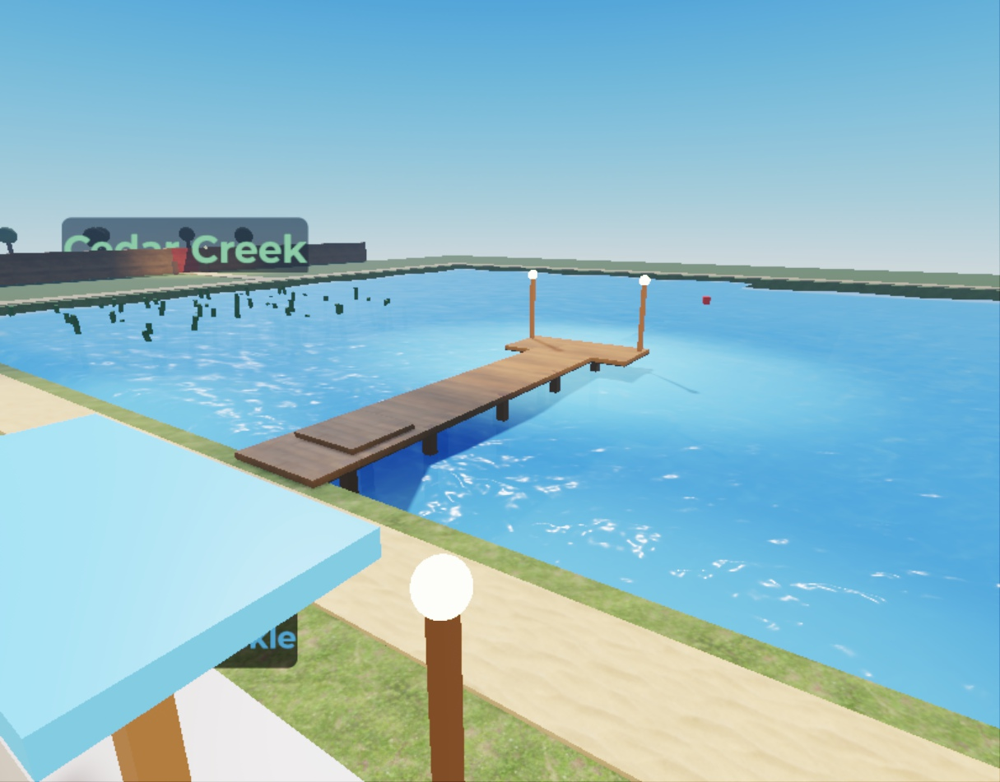 | 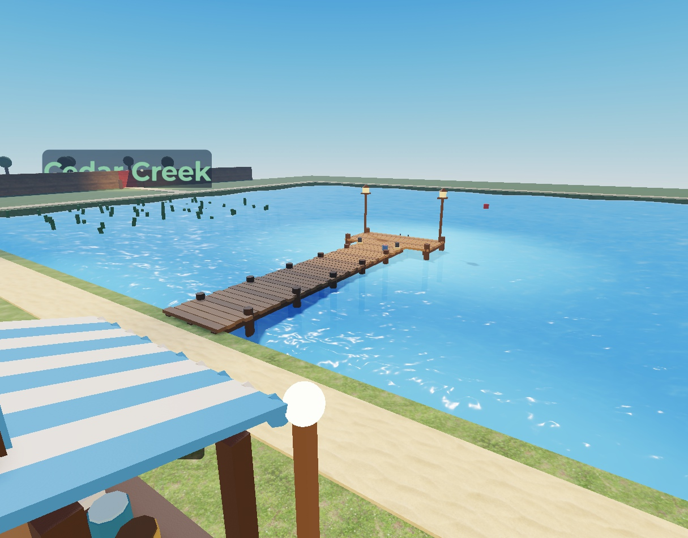 |

**Bait and Tackle, gray box and model**

| Before | After |
|---|---|
|  | 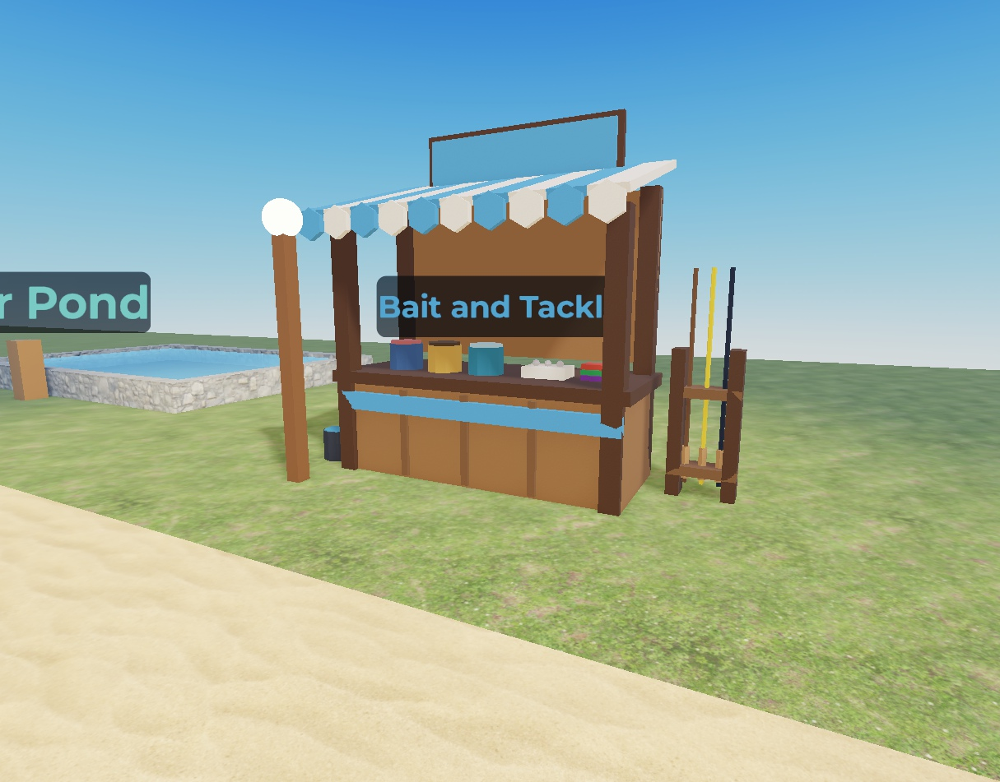 |

*Standing at the end of the new dock*

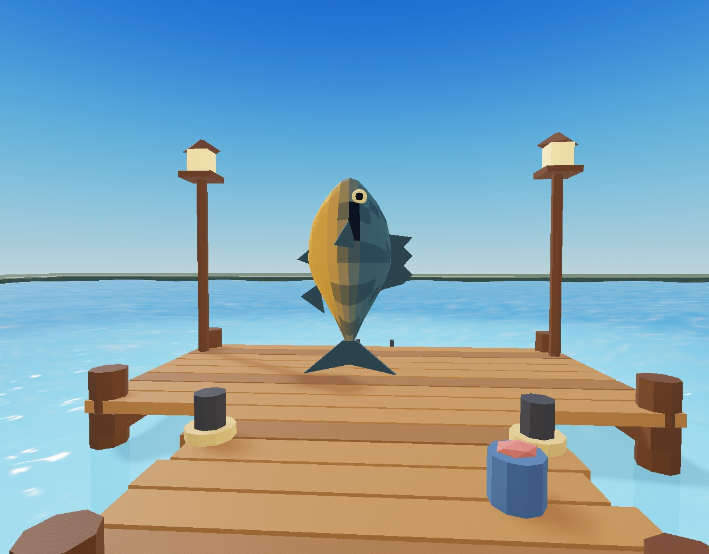
*A bluegill as it hangs on the line*

## Sound: The lake comes alive with sound

2026-11-26 11:30 · commit `f132de3`

Twenty-seven sounds made with ElevenLabs are now in the game. Birds at dawn, a loon at dusk, frogs at night, and running water that gets louder as you walk to the creek. While you wait, the world goes quiet and the bobber ticks; every kind of bite has its own sound, from a light tap to a deep pull for a catfish. The reel clicks faster when a fish is about to get away, the drag zips when it runs, and a catch ends on a splash sized by the fish and a little tune. A critic model listened to playtest clips and scored it 6 out of 10; after fixing the heavy cast splash, the quiet bites and a late chime it scored 7.

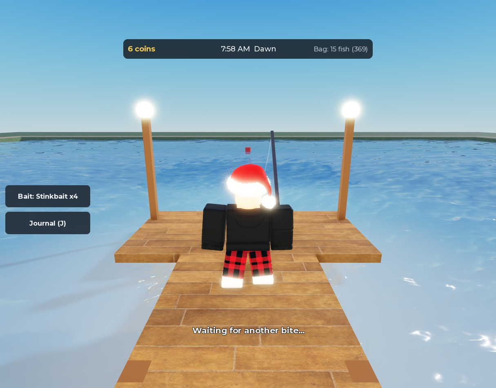
*The quiet wait at dawn, where the bobber ticking does the work*

## Fix: Every fish bites and fights its own way

2026-11-26 10:30 · commit `c0f7a77`

Panfish now nibble the bobber before they take it, perch and trout tap, bass and pike slam it under, and catfish pull it slowly down. On the bar each kind moves differently: bass run back and forth, pike make huge jumps and dive, catfish stay low and steady, trout sit low and then leap. A fish left alone slips the hook, and the bar flashes KEEP REELING! once you stop. Prices were rebalanced so a good spot pays and the Creek Pass now costs 500. The playtest also found that the best rod cast too far to fish the narrow creek; soft casts are short again with any rod.

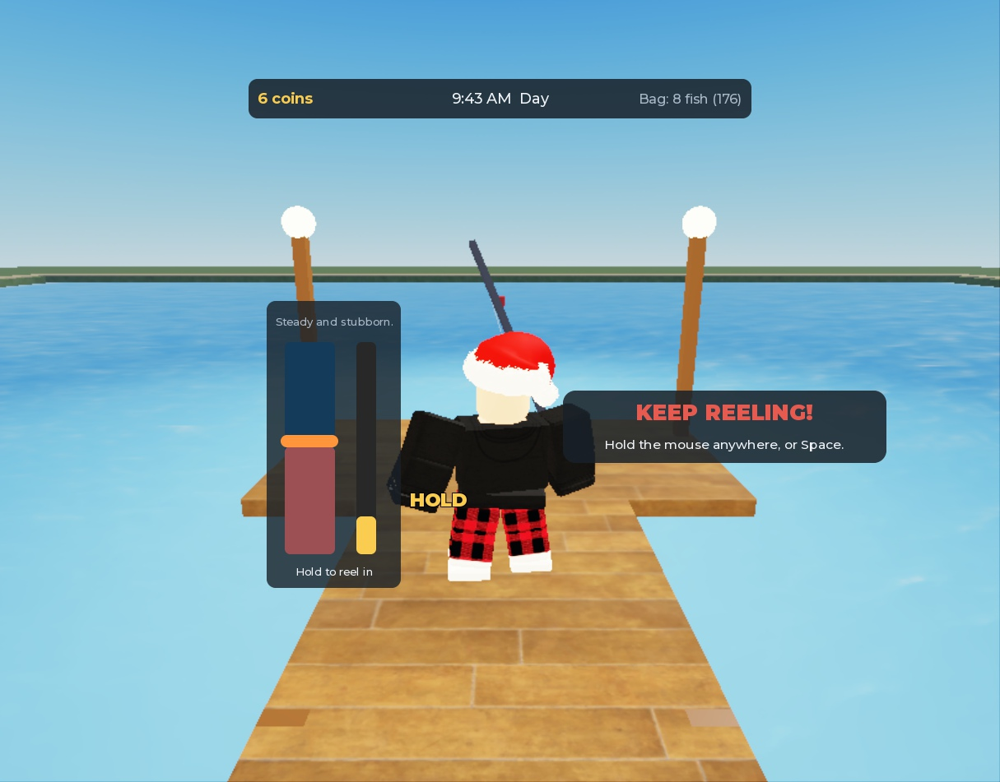
*Stop reeling and the bar warns you before the fish slips away*

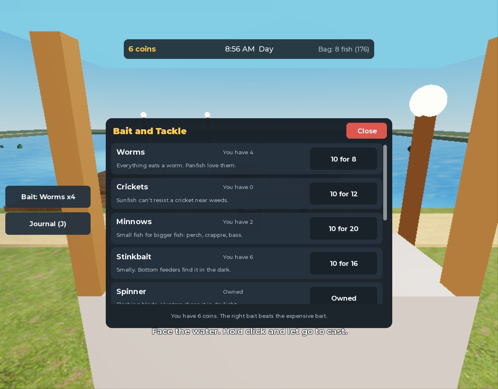
*Bait and Tackle with the new prices*

## Art preview: Our own models, first set (Blender previews)

2026-11-26 01:50 · commit `368c415`

An art preview, not yet in the game. Thirty-two low-poly models built by script in Blender overnight: the dock, both market stands, the pond's stone rim, logs, a buoy, reeds, lily pads, pines, a leafy tree, rocks, all eleven fish in their real colours and at true relative size, the three rods with reels, the bobber, and a Jon boat for the boat to come. Each is one mesh with baked colours, sized in studs to drop onto the gray box it replaces. These are renders from Blender; they still need to be imported and checked in Studio.

*All 32 models (Blender renders, not in the game yet)*

*Bluegill, with its dark ear flap and orange belly*

*The new dock, the same size as the gray-box one*

## Next: Cedar Creek

2026-11-25 20:20 · commit `cb022b1`

A stream west of the lake behind a tall fence. A 250 coin Creek Pass opens the gate. Its riffle, rocks and deep pool each hold a new fish: rainbow trout at dawn, smallmouth bass by day, walleye after dark. In the playtest the gate blocked the way until the pass was bought, then three trout, three walleye (up to 70 cm and 72 coins) and two smallmouth came out of the creek. The first look found the riffle's water missing; it was too thin for Roblox terrain and now fills properly.

**The west side before and after Cedar Creek**

| Before | After |
|---|---|
|  | 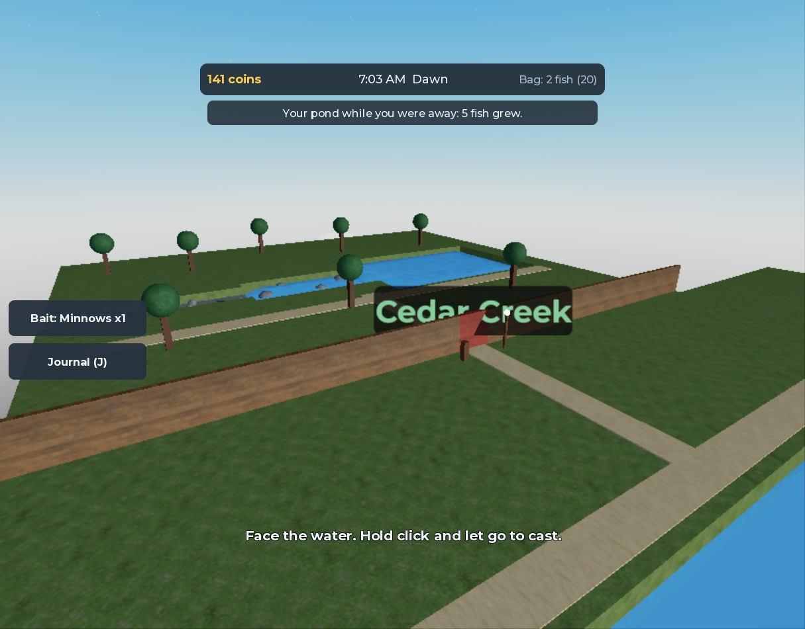 |

*The riffle and the rocks, looking upstream*

## Next: Better rods

2026-11-25 19:55 · commit `dc2dd04`

Bait and Tackle now sells rods. Everyone starts with the Willow Rod; the Fiberglass Rod (120 coins) casts 8 studs further and gives a bigger catch zone, and the Graphite Rod (350 coins) casts 16 studs further, has the biggest zone and takes half the pull out of heavy fish. The rod in your hands changes to match. In the playtest a full-power cast went 40 studs with the Willow Rod and 48 with the Fiberglass Rod.

**Bait and Tackle before and after the Rods section**

| Before | After |
|---|---|
| 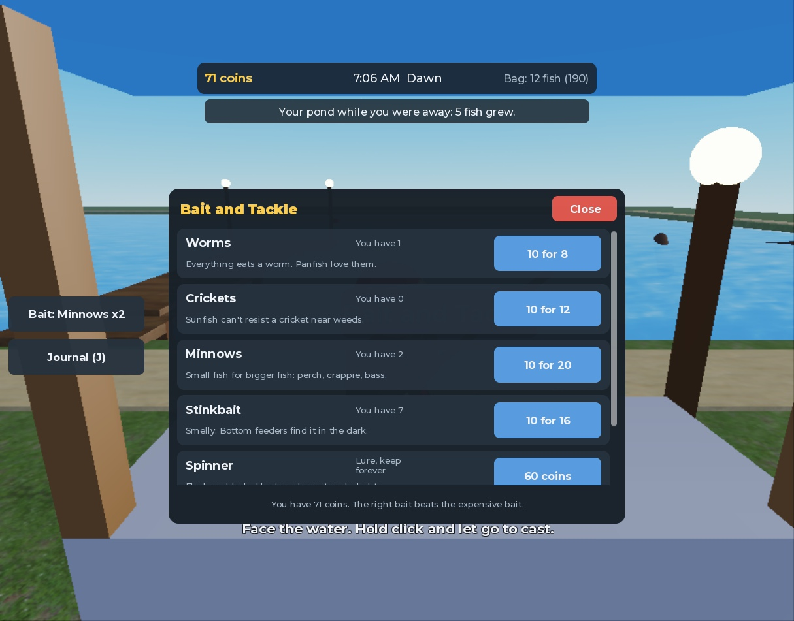 |  |

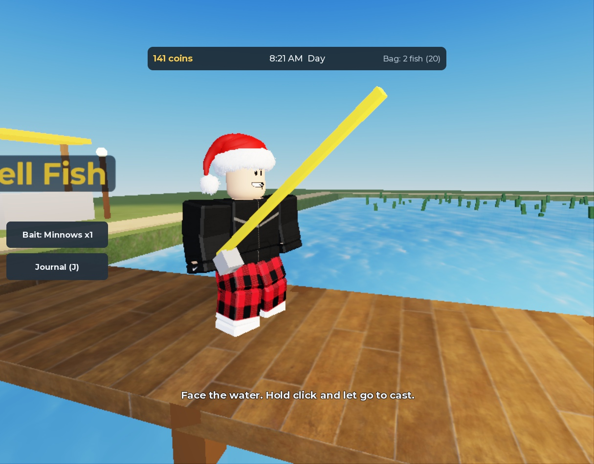
*The yellow Fiberglass Rod in hand*

## Next: Your own pond

2026-11-25 19:25 · commit `2b41b0e`

A stone pond next to the shop where you keep fish from your bag, up to 6 at a time. They grow toward full size while you play and while you're away (up to 8 hours), two grown fish of a kind can have babies, and you sell them later at their bigger size or let them go. Each player sees their own fish swimming in it. In the playtest a bass worth 34 coins when caught sold for 50 after three hours of pond time, and the pond kept all its fish after a restart. Breeding was then slowed down after four babies arrived in three hours.

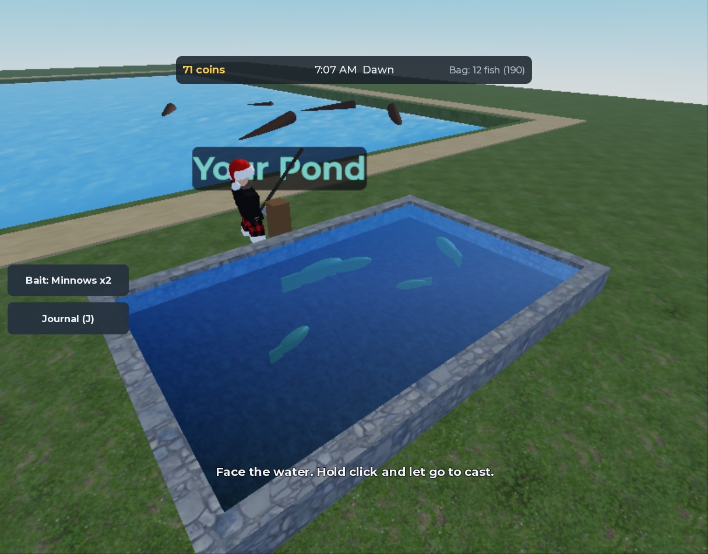
*Five bass swimming in the pond*

*The pond sign and its Check pond prompt*

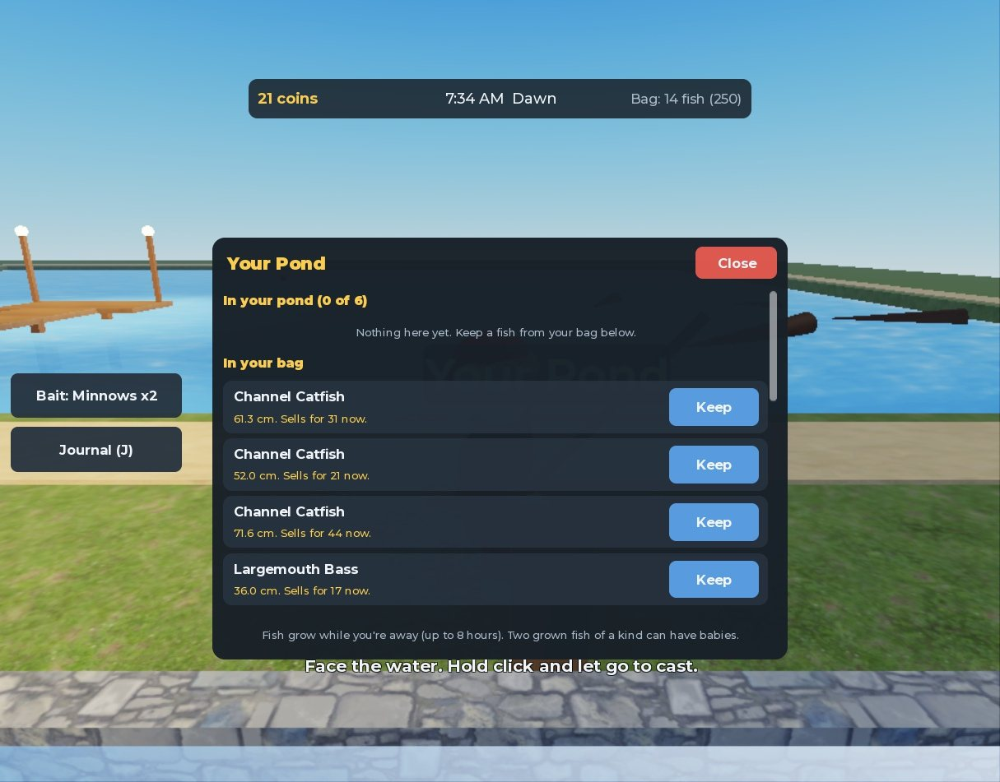
*Choosing which fish from the bag to keep*

*A kept bass swimming in the pond*

*Baby bass in the pond panel after three hours of pond time*

## Polish: Fish shadows, the catch on the line, night lamps

2026-11-25 19:11 · commit `34d1104`

Fish shadows now swim where the bite rules say fish should be, a landed fish hangs on the line before it goes in the bag, and lamps on the dock light up the water at night.

**Night at the dock, before and after the lamps**

| Before | After |
|---|---|
|  |  |

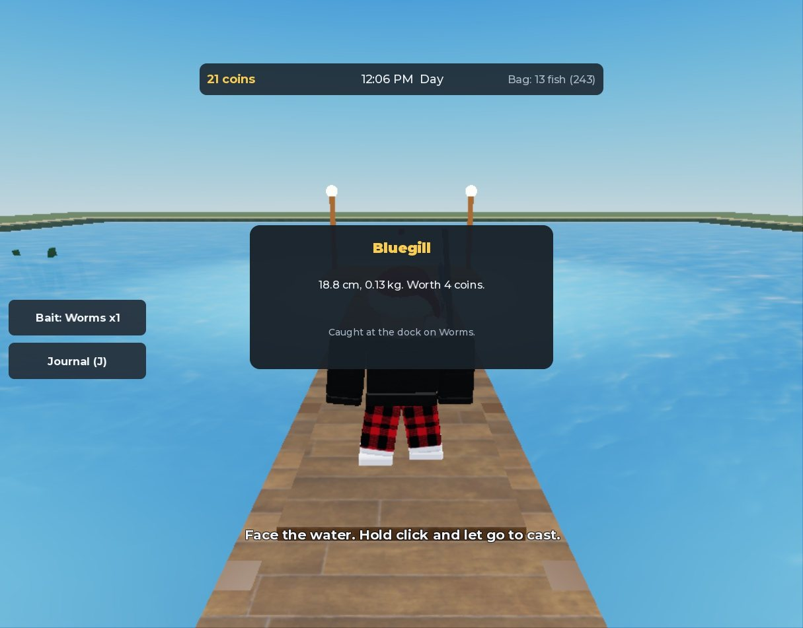
*A bluegill held on the line*

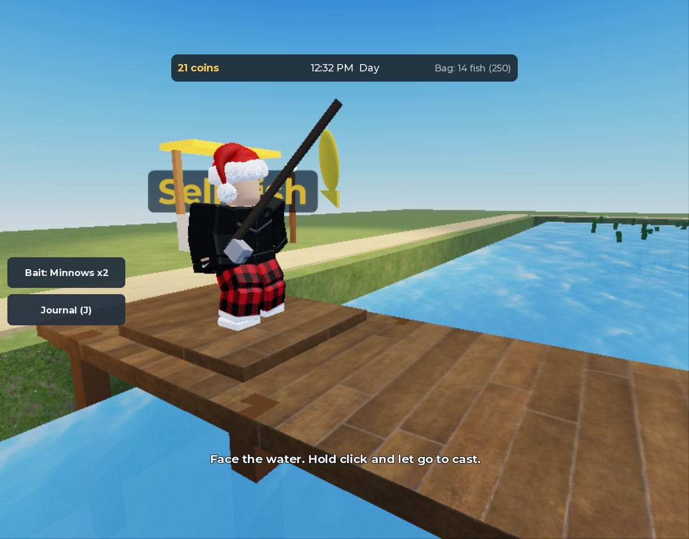
*The Sell Fish sign*

*A dock lamp by day*

## Fix: The reel always answers

2026-11-25 19:06 · commit `6198609`

The first playtest found that clicking sometimes barely moved the catch zone, and clicks on some parts of the screen lost the fish. Now any click or hold anywhere on screen reels, the player's pull always beats the fish's, buttons step aside during a fight, and a big REELING! prompt shows that it is working.

**The fight: before, and after with the hold-anywhere REELING! prompt**

| Before | After |
|---|---|
| 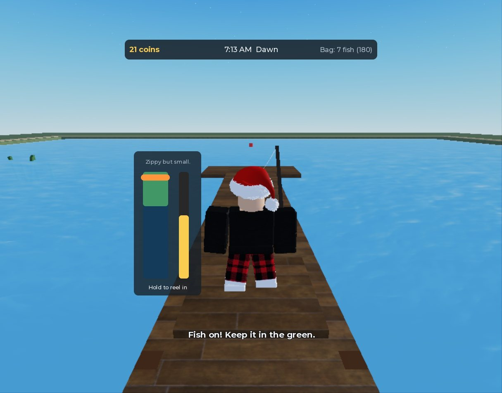 |  |

*The same fight on a phone, with a big REEL button*

## M6: Phone and controller

2026-11-25 18:43 · commit `04d3e64`

On the smallest phone in Studio's simulator, the first pass found a tiny touch button sitting on top of jump, a fight panel over the top bar, and a journal taller than the screen. All fixed: a big Fish button, a moved and shorter fight panel, panels that shrink to fit. Gamepad works too: R2 to cast and reel, Y for the journal. Version 1 complete.

**Phone layout: the tiny touch button, then the big Fish button**

| Before | After |
|---|---|
|  | 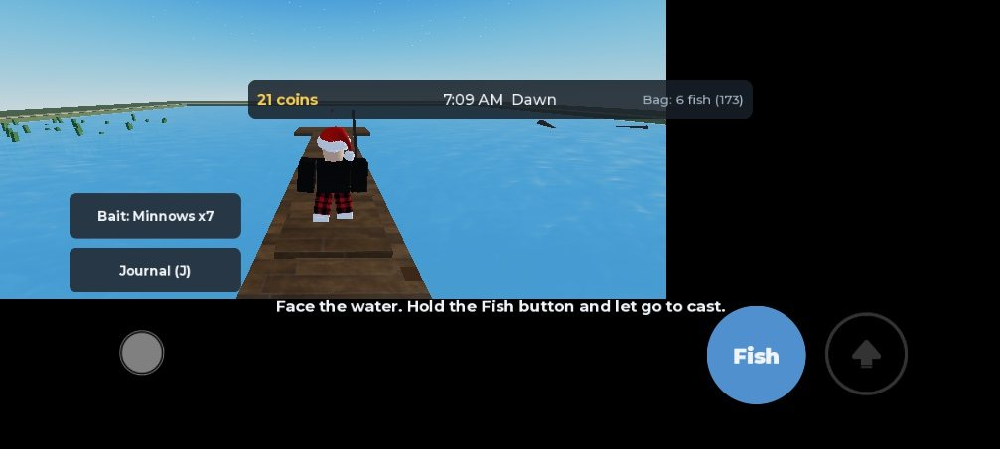 |

*Fighting a fish on a phone*

*The journal on a console screen*

## M5: Fish journal and saving

2026-11-25 18:35 · commit `33e0c7f`

Press J for the journal: every species with its count, best weight and length, the bait and spot it was caught on, and a habit tip once you've caught one. Undiscovered fish show as question marks. Coins, bait and the journal save to Roblox and come back after leaving.

*The fish journal, 5 of 8 species found*

## M4: Money and the bait shop

2026-11-25 18:35 · commit `33e0c7f`

The Fish Buyer pays coins, worked out on the server so nobody can cheat it. Bait and Tackle sells worms, crickets, minnows, stinkbait and a spinner, and the bait on your hook changes what bites. Six fish sold for 27 coins in the first test.

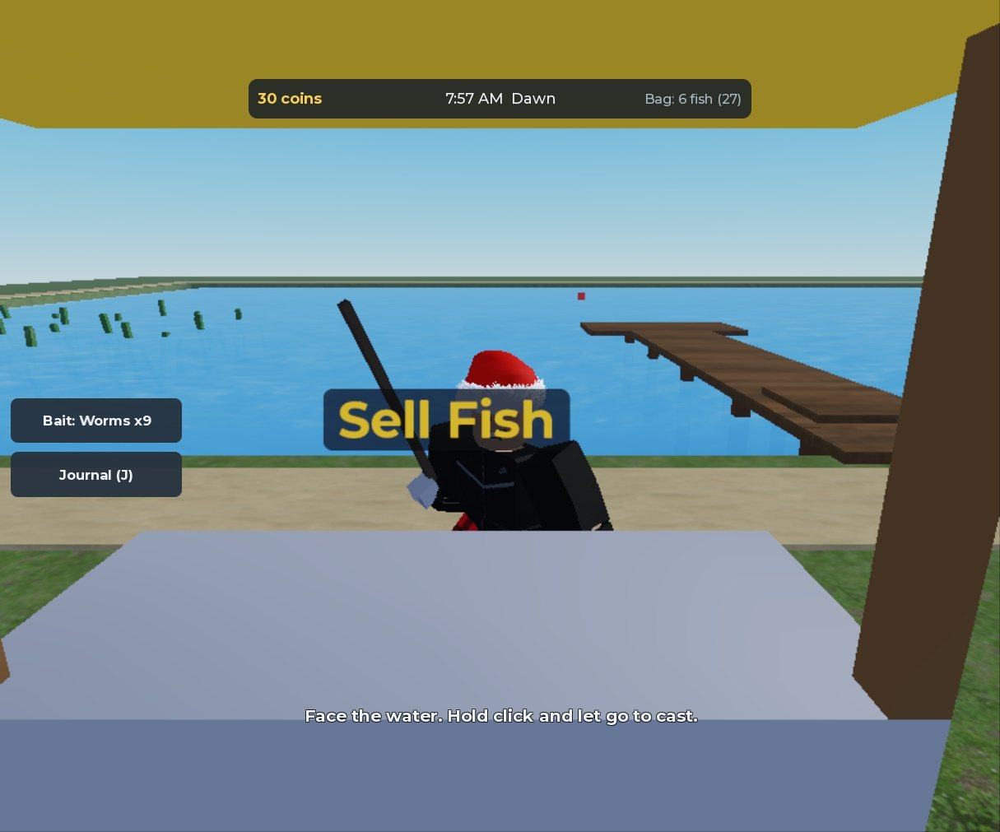
*The Fish Buyer stand*

*Bait and Tackle: each bait says which fish it suits*

## M3: Real fish habits

2026-11-25 18:35 · commit `33e0c7f`

Eight species, each with its own spots, feeding times, baits, sizes and fight. Tested by fishing them the real way: perch and bluegill at the dock at dawn on worms, largemouth bass at the weed bed at dawn on minnows, channel catfish in the deep hole at 10 PM on stinkbait. The wrong bait at the wrong spot gets a hint instead of a bite.

*10 PM at the end of the dock, stinkbait in the deep hole: catfish time*

## M2: Cast and catch

2026-11-25 18:29 · commit `af16abb`

Hold and release to cast, wait for a bite, hook it, then keep the fish in the green zone until the bar fills. A cast onto dry ground is refused with a hint. The first fish landed was a 19.2 cm pumpkinseed worth 6 coins. The hook window went from 1.6 to 2 seconds to be kinder to young players and touch screens.

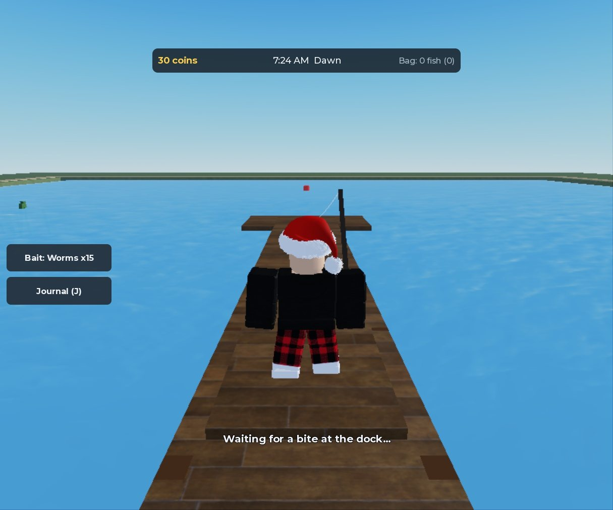
*Line in the water, waiting for a bite at the dock*

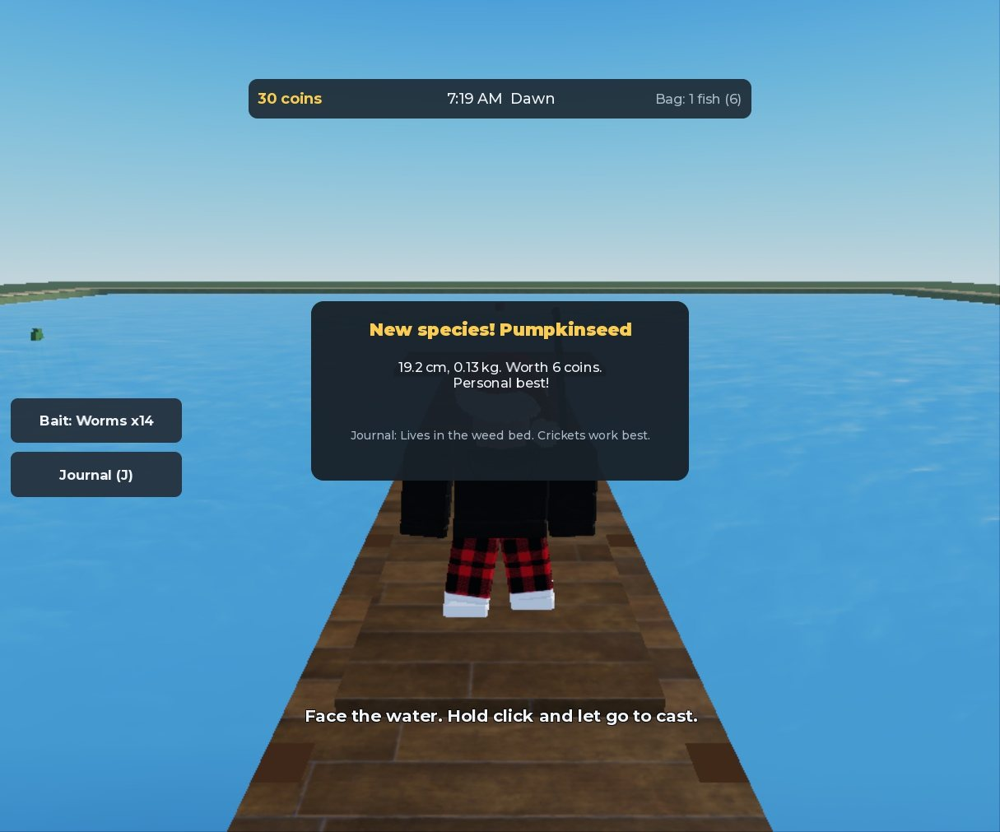
*First catch: a new species card for a pumpkinseed*

## M1: Gray-box lake

2026-11-25 18:29 · commit `af16abb`

A lake built entirely by script: terrain water, a dock from the south shore, a weed bed, five fallen logs, a deep hole marked by a red buoy, a shore path, and two stands. Players spawn on the dock with a rod. A 16 minute day runs from dawn to night.

*The whole lake from above: dock, weed bed, logs, deep hole buoy, and the two stands*

*First spawn, rod in hand*

## M0: Pipeline: code in Git, pushed into Studio

2026-11-25 18:29 · commit `af16abb`

All game code lives as files in the repo and is pushed into Studio script by script, then checked byte for byte. A test script made the full round trip: created, read back, run in a playtest, logged, deleted. 22 scripts and 23 unit tests went in.

## Start: Design approved, empty Baseplate

2026-11-25 18:07 · commit `32f4cd8`

The plan: one lake that plays well before anything else, built from plain gray blocks. Eight real lake fish with real habits, a bar minigame that starts easy, a sell stand, a bait shop, a fish journal, and saving. The research behind it found that the biggest Roblox fishing games reward collecting but never real fishing knowledge, so that became the hook. Built by Claude Opus 5.5 working inside Roblox Studio through Studio's MCP server.
