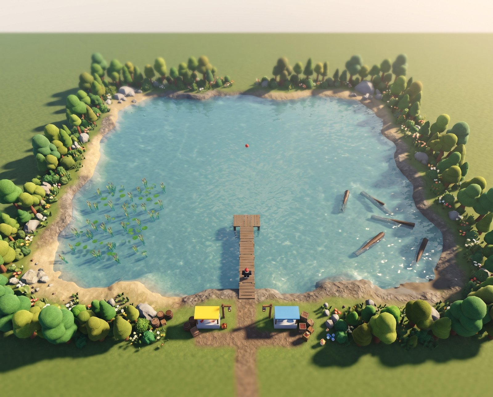
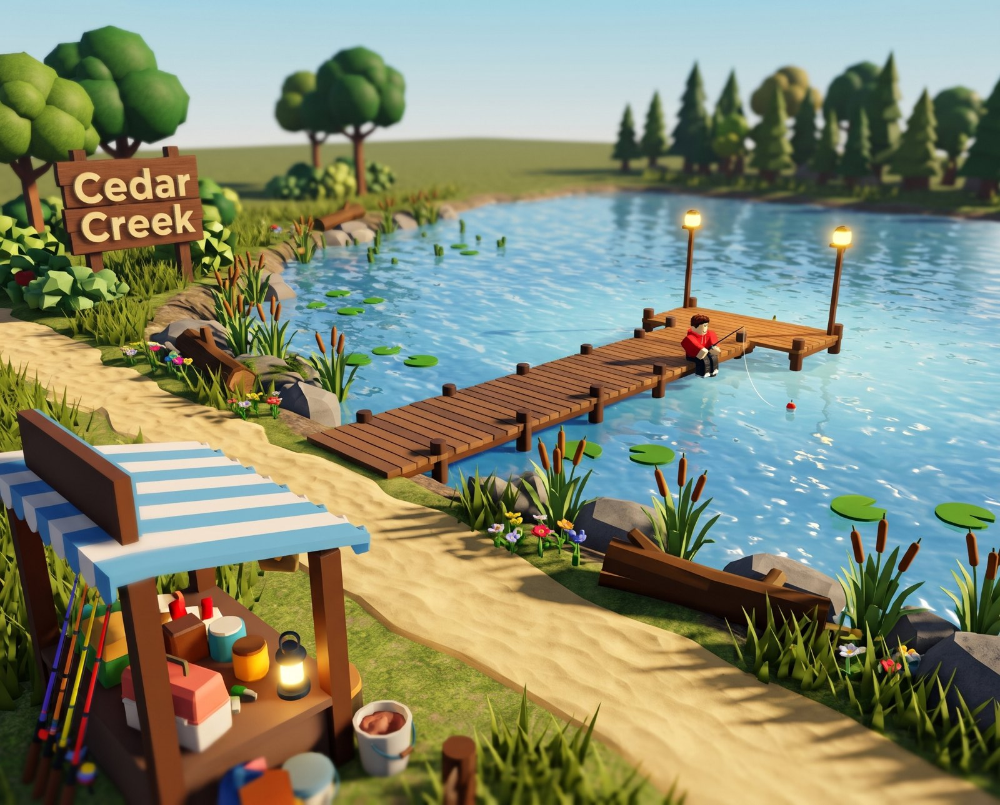
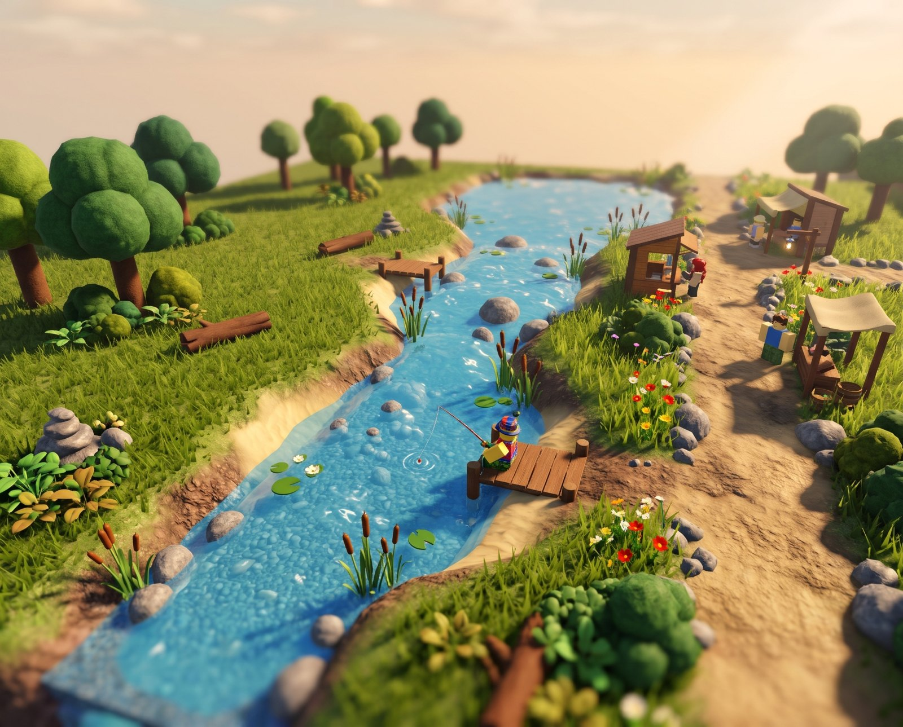
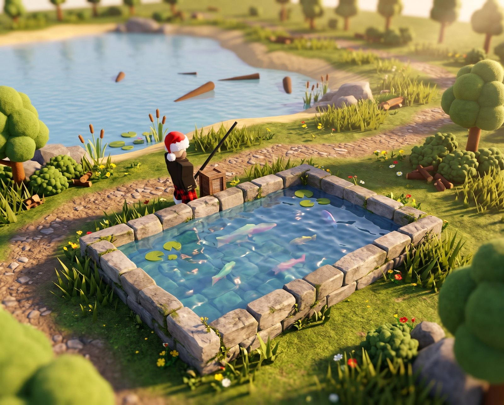
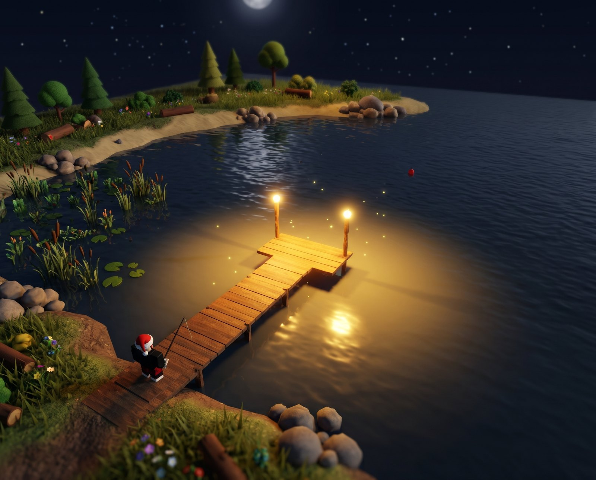

# Cozy Diorama

The whole place looks like a tiny handmade model on a table.

| The lake | The dock | Cedar Creek | Your pond | Night |
|---|---|---|---|---|
|  |  |  |  |  |

## What it would take

**In Roblox**
- Toy-like props: rounded, bevelled shapes, slightly oversized details (big bobbers, chunky lamps), soft felt-like or painted-wood colours. MaterialVariants with a fabric or felt look can help on bigger surfaces.
- The tilt-shift "miniature" blur is Roblox's `DepthOfFieldEffect`. It blurs the whole screen by distance, so it suits menus, the map, a photo mode or the journal, not everyday play where the player needs to see far across the water.
- A higher, more top-down camera sells the toy look best. That would change how fishing feels, so it would be an extra overview camera, not the main one.
- Warm afternoon light, soft shadows, a playful saturated palette.

**In our pipeline**
- Mostly the same: vertex-coloured Blender models with more bevel and rounder shapes (a rounding option in `common.py`). A few textures for felt and wood grain if we want them.
- Optional: build each place as an "island" with a visible edge (a wooden base or a cliff), which also hides the edge-of-the-world problem.

## Phone performance risk: low to medium

The models and light are cheap. Depth of field is the cost to check on the smallest phone; keep it to menus and the overview camera, and test it in the Device Simulator against the L0 frame budget.

## Rough effort: medium

About 4 to 6 build sessions: rounder model variants (2), light and palette (1), the overview camera with depth of field (1), island edges and dressing (1 to 2).

## What changes from today

The props get rounder and more toy-like, the colours warmer and brighter, and we gain a "model on a table" overview. In normal play it looks close to the Golden Hour Low-Poly option with cuter props; the miniature effect mostly shows in the overview and menus.

## Critic (Gemini 4 Neon)

**Overall 8.2/10**: beauty 8.6, mood 8.9, reads on a phone 6.8, suits kids 8.5. All five images judged together; full verdict in `critic.json`.

> It feels like playing inside a cozy, glowing toy fishing park built right on your bedroom table.

These score the concept images, not the game. The real gray-box lake scored 2.5 to 3 on the same critic, so the scores compare styles with each other, not with today.

What it liked:
- Warm sunlight, glowing dock lanterns, and soft shadows create an inviting atmosphere that makes players want to linger.
- Chunky wooden docks, striped tackle stalls, and stone ponds look handmade and toy-like, giving the game a distinct identity on Roblox.
- The night scene adds real mystery and gentle tension, proving this cozy style can still feel exciting when waiting for a bite.
- Classic blocky Roblox avatars blend naturally into the miniature world instead of looking out of place.

Risks it saw:
- Strong tilt-shift blur looks great in stills, but Roblox depth-of-field effects can hurt phone performance and shrink the usable view on small screens.
- Small bobbers and thin fishing lines get lost against busy grass, bright water ripples, and dark night water on mobile displays.
- Dense blades of grass, soft global lighting, and clear pebble-bottom water are hard to match on budget phones without causing lag or looking plastic.
- Zoomed-out angles reveal flat empty ground beyond the trees, which breaks the handmade diorama feeling unless edges are carefully disguised.

Weakest image: lake.jpg
