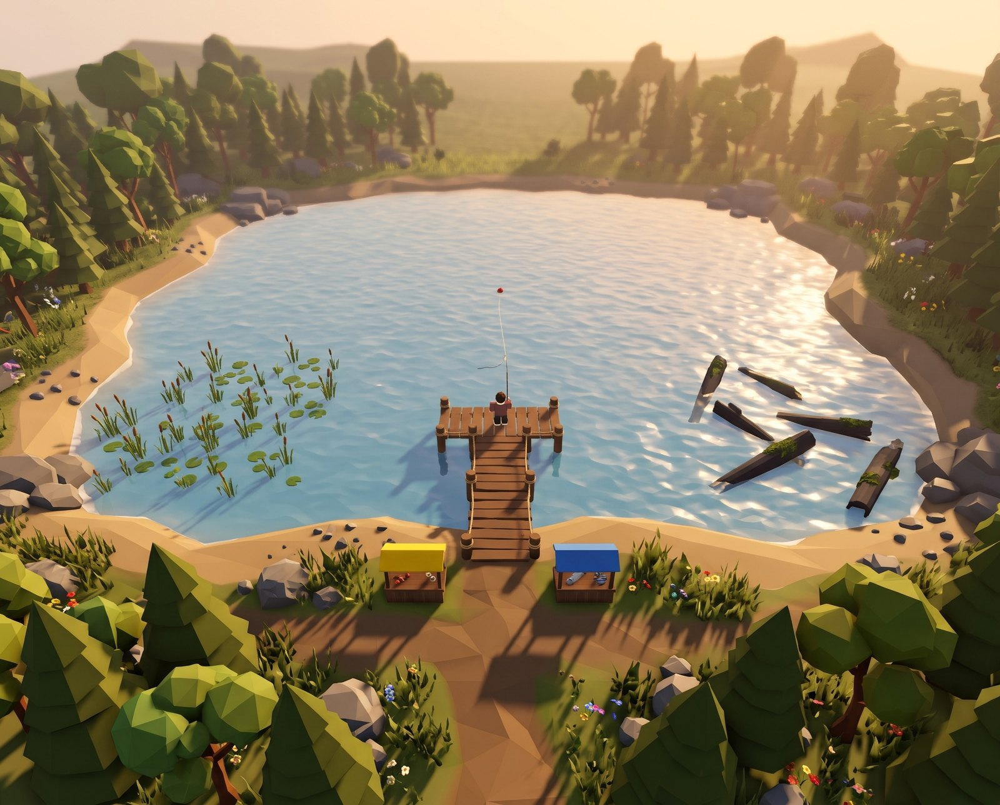
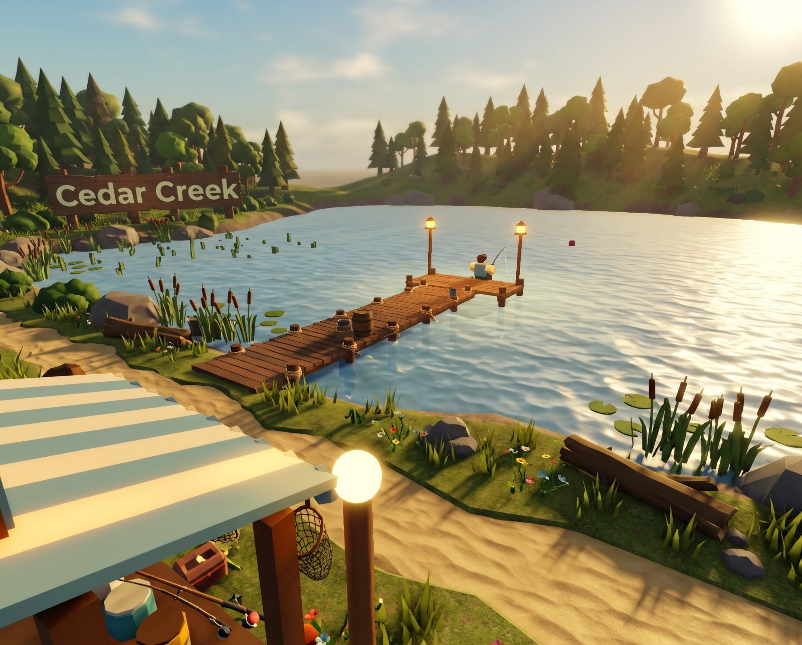
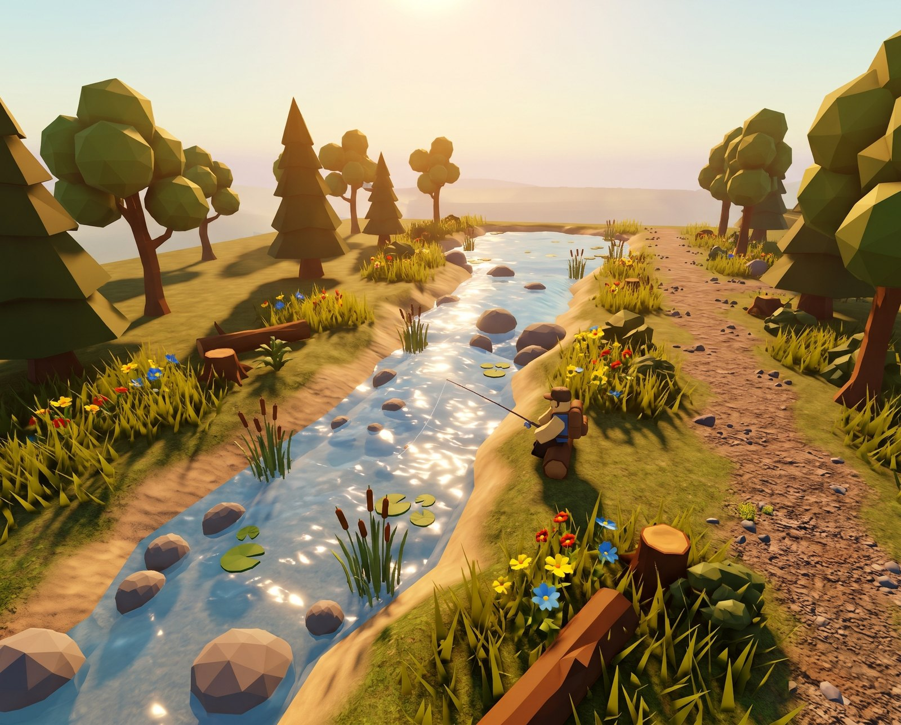
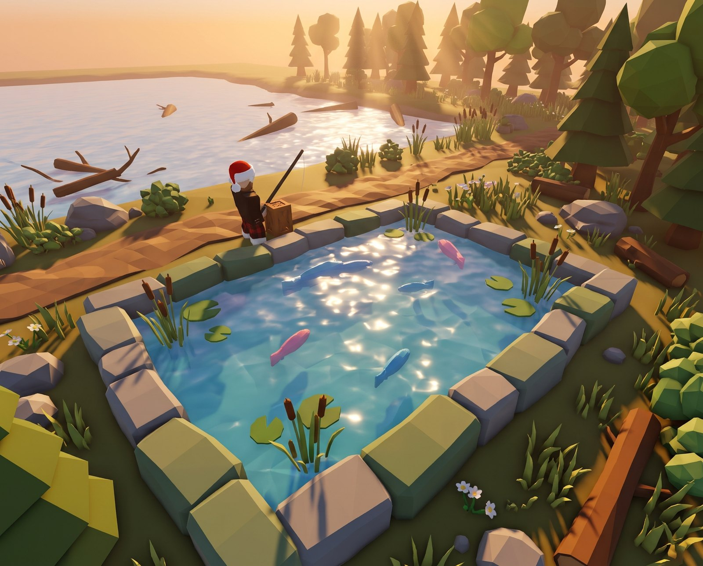
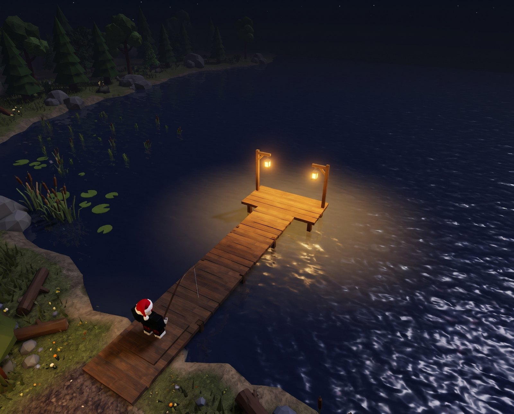

# Golden Hour Low-Poly

Our current chunky low-poly look, done really well at golden hour.

| The lake | The dock | Cedar Creek | Your pond | Night |
|---|---|---|---|---|
|  |  |  |  |  |

## What it would take

**In Roblox**
- Lighting does most of the work: Future lighting, a warm ColorCorrection tint and contrast, Atmosphere haze and glare, SunRays and a soft Bloom, with presets that blend through the day. Golden hour (about 17:30 to 18:45) is the showpiece.
- Terrain replaces the gray-box slabs: grass, sand and rock painted with soft, irregular shorelines, and terrain water tuned for colour, clarity, reflectance and wave size per place.
- Props scattered by `WorldBuilder` from code: pines, leafy trees, reeds, lily pads, rocks and logs, as in the images.

**In our pipeline**
- Nothing new. The Blender scripts in `art/scripts/` already make these props (PineTall, PineShort, LeafyTree, Reeds, LilyPads, rocks, logs) with flat vertex colours, and the import path (`roblox_colors.py`, Open Cloud upload, `WorldBuilder.dress`) is proven on the dock and bait stand.
- More of the same: ferns, cattails, wildflowers and a few bigger hero trees, each a short Blender script on the shared palette.

**What we could not match exactly:** the faceted, low-poly ground and water in some images. Roblox terrain is always smooth, so ground and water stay smooth unless we model the ground as meshes (possible for small areas, not worth it for the whole lake). The faceted look lives in the props, which is where it reads anyway.

## Phone performance risk: low

Flat vertex colours cost no texture memory, and every model is a single small mesh (the biggest is about 1,400 triangles). The things to watch are the number of props on screen and the post effects; Atmosphere, ColorCorrection and Bloom are cheap. Check SunRays and shadow-casting lamps in the Device Simulator at the smallest phone against the L0 frame budget.

## Rough effort: small to medium

About 3 to 5 build sessions for the lake and creek: lighting presets (1), terrain shoreline and water (1 to 2), prop dressing and a few new props (1 to 2). This is close to what the L5 beauty pass already plans.

## What changes from today

Little in how we work; a lot on screen. The house style in `art/README.md` stays as it is. The change is light, water, shoreline and filling the empty horizon with trees, which the leg plan already names as the four things that cover most of the frame.

## Critic (Gemini 4 Neon)

**Overall 8.2/10**: beauty 8.5, mood 8.8, reads on a phone 6.8, suits kids 8.6. All five images judged together; full verdict in `critic.json`.

> It feels like fishing at a cozy summer camp right before sunset, where chunky low-poly woods and water glow in warm golden light.

These score the concept images, not the game. The real gray-box lake scored 2.5 to 3 on the same critic, so the scores compare styles with each other, not with today.

What it liked:
- Warm golden sunlight and crisp shadows make simple chunky models look polished and intentional, which is realistic for a two-person team to build in Roblox.
- Cool blue water contrasts cleanly against warm wooden docks and sandy banks, helping key play areas and landmarks like the Cedar Creek sign stand out.
- The look fits naturally with Roblox avatars and feels adventurous and calm for 8 to 13 year olds without looking babyish.
- Small touches like glowing lanterns, wildflowers, and colorful stalls add charm and guide the player's eye across the map.

Risks it saw:
- Heavy white sun glare on the water in creek.jpg and pond.jpg washes out the fishing line, bobber, and underwater fish, which will hurt gameplay on a small phone screen.
- Roblox lowers lighting quality, bloom, and shadows on budget phones, and chunky low-poly art can look flat and dull when those lighting effects turn off.
- Dark areas in night.jpg become hard to read outside the small lantern circle, especially if a kid is playing on a phone in a bright room.
- The concept images mix realistic gravelly paths in creek.jpg with clean faceted low-poly paths in lake.jpg and pond.jpg, so you must pick one consistent ground style to avoid a mismatched look.

Weakest image: night.jpg
