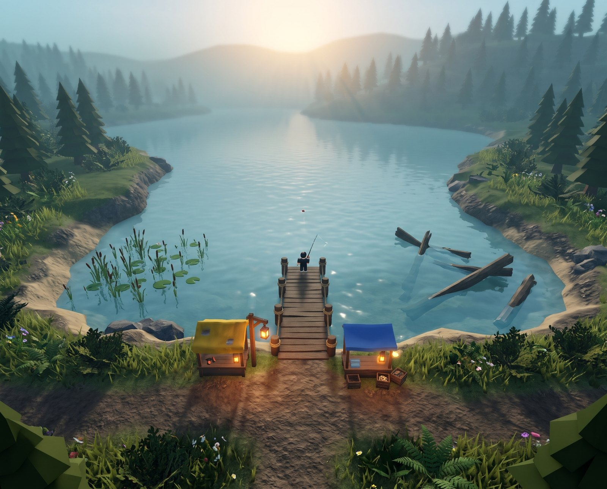
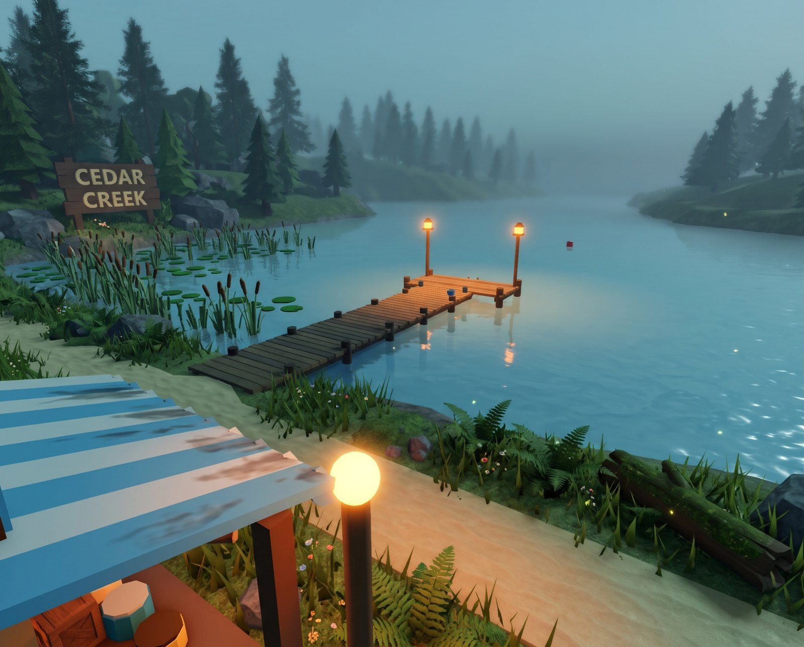
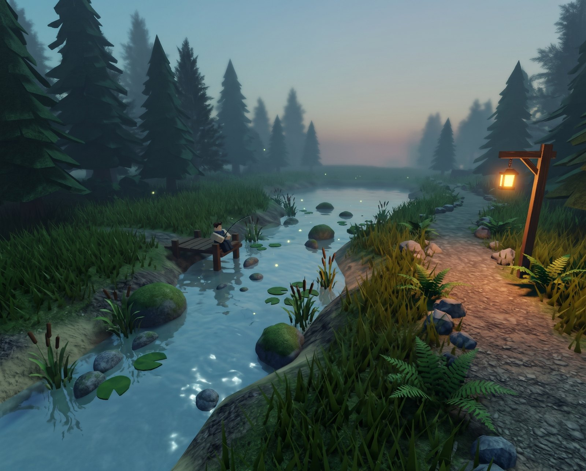
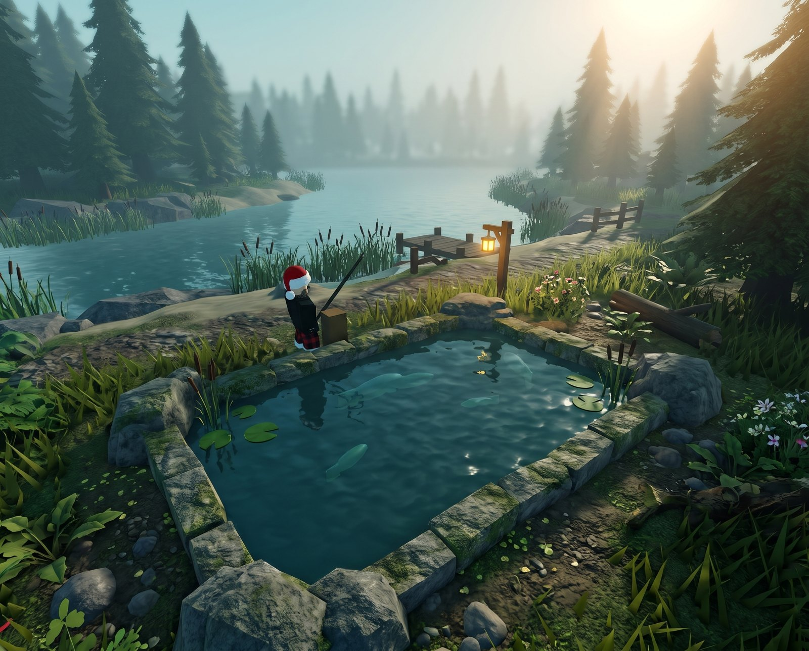
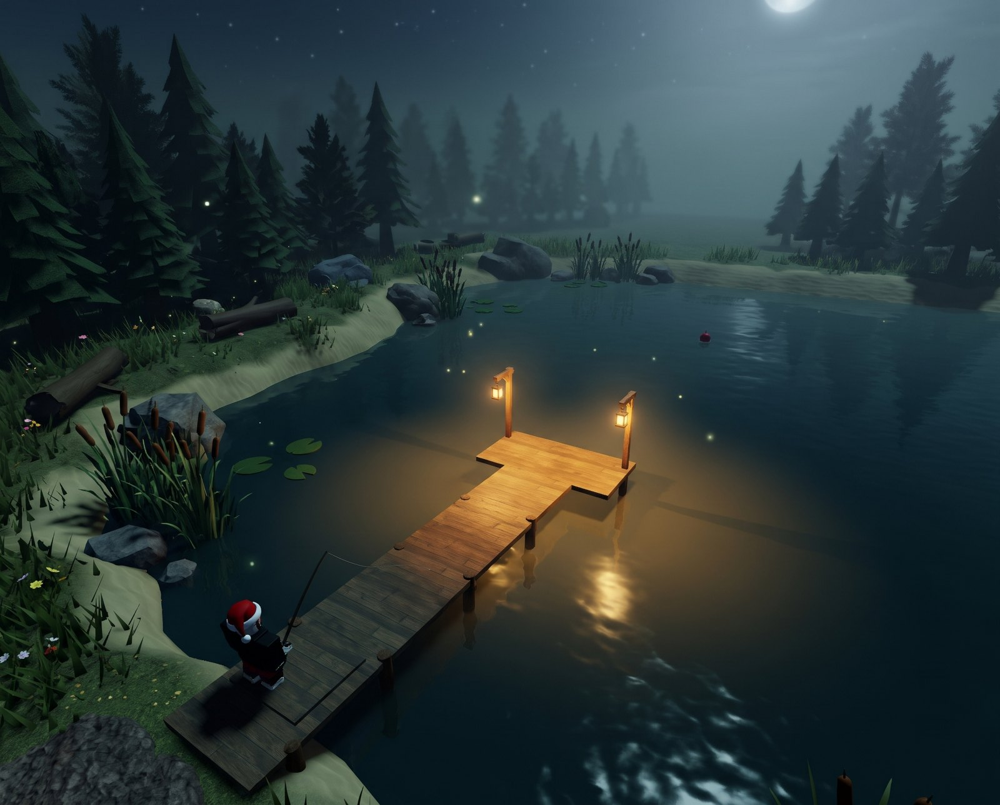

# Misty Morning

Mist, dark pines and soft blue light: quiet and a bit mysterious.

| The lake | The dock | Cedar Creek | Your pond | Night |
|---|---|---|---|---|
|  |  |  |  |  |

## What it would take

**In Roblox**
- Almost all of it is light and air: Atmosphere with high density and haze, a cool ColorCorrection, a low sun, Bloom on the lamps, and PointLights on the lamps and the shop.
- Calm, glassy terrain water (small waves, higher reflectance, a darker colour).
- Dark pines in layers fading into the mist, so the horizon disappears into fog instead of showing the edge of the world.
- Mist particles low over the water at dawn.

**In our pipeline**
- Nothing new. The pines exist (PineTall, PineShort); a darker palette entry and a few more tree variants are enough.

## Phone performance risk: low

Atmosphere and ColorCorrection are cheap, and fog hides distant props so fewer need drawing. Watch how many lamp lights cast shadows, and keep the mist particles light.

## Rough effort: small

About 2 to 3 build sessions, and most of it overlaps the Golden Hour work: a misty lighting and weather preset, water settings, layered trees.

## What changes from today

Very little in how we build. The risk is the look itself: all day long it would be dim and low in contrast, which is harder to read on a small phone outdoors and less cheerful for kids. It works best as a mood the world passes through (dawn, fog weather, the deep hole at night) on top of another style, rather than as the whole game's look.

## Critic (Gemini 4 Neon)

**Overall 7.9/10**: beauty 8.6, mood 9.1, reads on a phone 6.3, suits kids 7.8. All five images judged together; full verdict in `critic.json`.

> It feels like sneaking out to a secret forest lake at dawn where a giant fish could be hiding right under the fog.

These score the concept images, not the game. The real gray-box lake scored 2.5 to 3 on the same critic, so the scores compare styles with each other, not with today.

What it liked:
- Strong warm against cool lighting, where golden lanterns and bright stall awnings naturally guide the eye toward docks and paths.
- Gorgeous layered pine silhouettes and soft morning mist that make the world feel much bigger and deeper than a typical Roblox map.
- Adventurous, slightly mysterious tone that respects older kids around 10 to 13 instead of looking babyish, which builds real anticipation for rare catches.
- Strong open composition in lake.jpg and dock.jpg, giving players calm water space to spot splashes and bobber movement.

Risks it saw:
- Dark avatars, thin fishing rods, and dark red bobbers get lost in shadow on a small phone screen, especially in night.jpg and creek.jpg.
- Dense detailed grass, mossy rocks, and soft water reflections look like high-end PC art and could cause lag or turn into visual clutter on budget phones in Roblox.
- Soft volumetric mist and warm lantern glow often break down or look flat when Roblox lowers graphics quality automatically on mobile devices.
- Muted dark greens and blues lose contrast when kids play in bright rooms, and the quiet shadowy mood may feel a little too gloomy for younger 8-year-old players.

Weakest image: night.jpg
