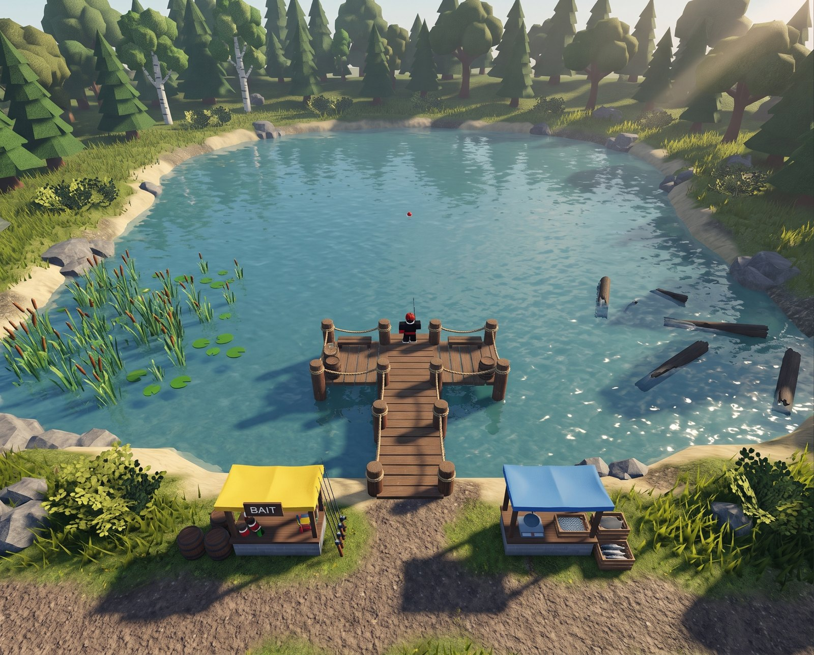
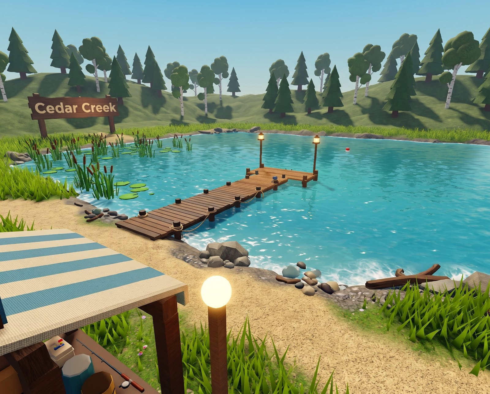
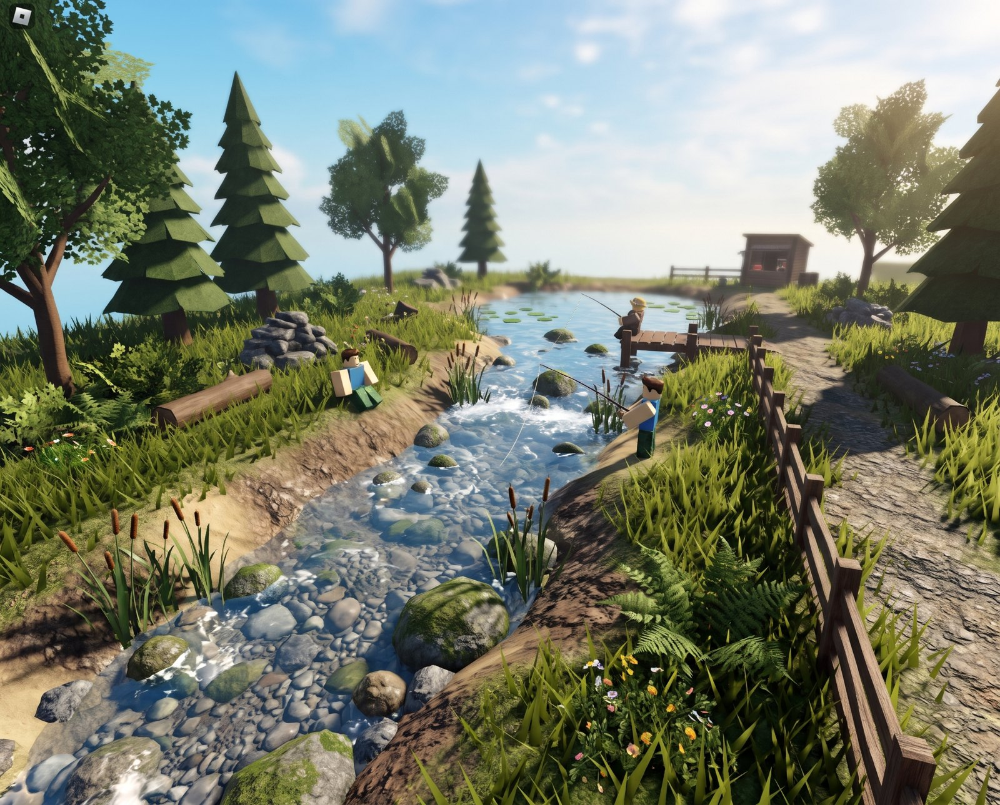
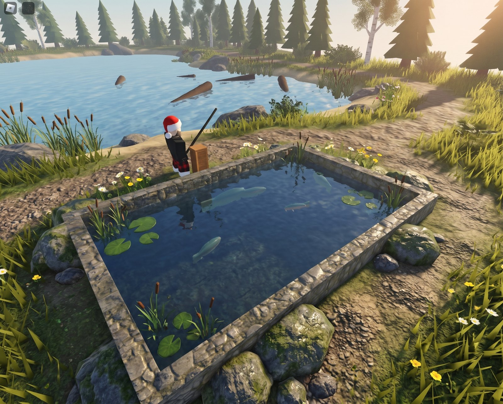
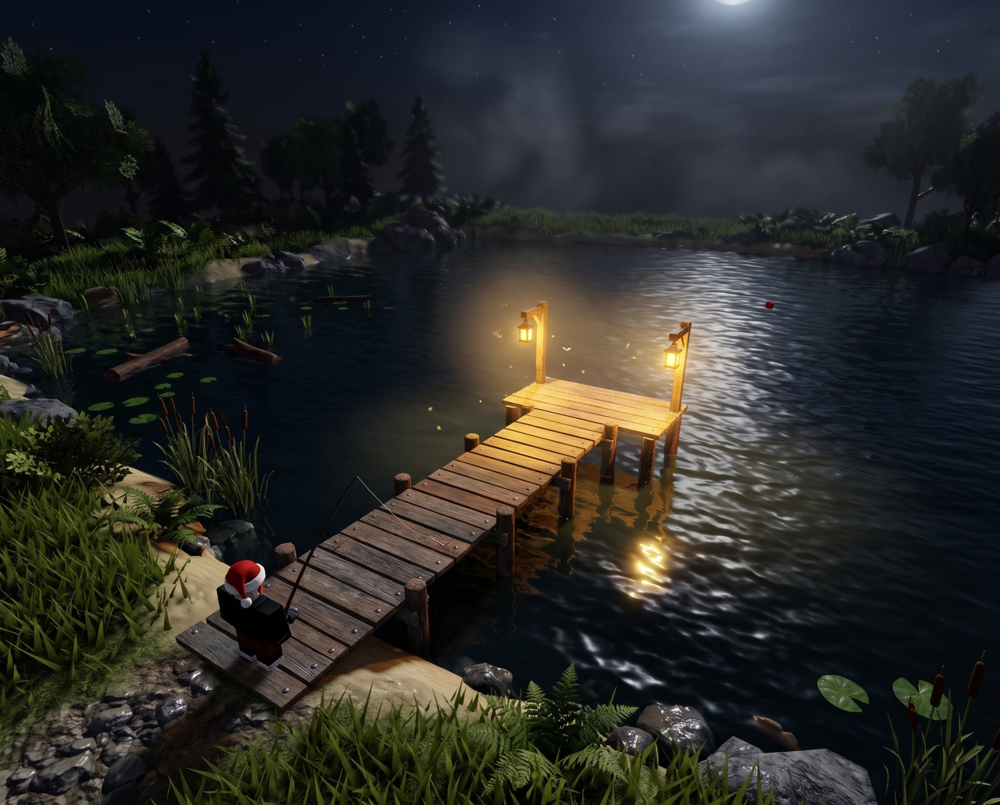

# Real-ish

Realistic materials (wood grain, wet stones, real grass) with simple shapes.

| The lake | The dock | Cedar Creek | Your pond | Night |
|---|---|---|---|---|
|  |  |  |  |  |

## What it would take

**In Roblox**
- `SurfaceAppearance` on every prop with full physically based maps: colour, normal, roughness and metalness.
- Roblox's own realistic terrain materials (grass, sand, rock, mud) are a good start; custom MaterialVariants for a closer match.
- Natural daylight, realistic water colour, grass decoration on terrain.

**In our pipeline (the big change)**
- Our scripted low-poly models don't hold realistic textures well. Props would come from Meshy (which makes textured models), or from Blender with properly unwrapped meshes and baked texture sets.
- Every prop needs four texture maps, kept small and shared to save memory. Fish would need realistic scale textures.
- Roblox avatars are blocky and cartoony, so they can look out of place in a realistic world.

## Phone performance risk: high

Texture memory and download size climb fast with four maps per prop. On a small phone, textures load slowly or show blurry, and loading takes longer. It can work, but it needs careful texture budgets, shared materials and testing on Stewart's phone at every step.

## Rough effort: large

About 10 to 15 build sessions before the lake and creek match the images, and every new fish or prop after that costs more than in the other styles.

## What changes from today

The house style is replaced: vertex colours, the flat palette and most of the Blender scripts give way to Meshy models and texture sets. It looks the most real and is the slowest, heaviest option, and the one most likely to clash with the Roblox avatars.

## Critic (Gemini 4 Neon)

**Overall 7.3/10**: beauty 8, mood 8.5, reads on a phone 5.5, suits kids 7.5. All five images judged together; full verdict in `critic.json`.

> It feels like going on a real weekend fishing trip in the woods, just with blocky Roblox friends.

These score the concept images, not the game. The real gray-box lake scored 2.5 to 3 on the same critic, so the scores compare styles with each other, not with today.

What it liked:
- Strong outdoor atmosphere, especially the warm lantern glow in night.jpg and the golden sunlight across the water in lake.jpg.
- Realistic wood grain, wet mossy stones, and water ripples make simple dock and pond shapes feel rich and grounded.
- The mix of cozy lit docks and deep, quiet water fits a calm-but-tense fishing loop very well.
- Bright focal props like the yellow and blue bait stalls in lake.jpg help anchor the scene against natural greens and browns.

Risks it saw:
- Busy textures like pebbles, dense grass blades, and sparkling water glare create visual noise on a small phone screen, making tiny bobbers and fishing lines hard to spot.
- Heavy PBR materials, dense foliage, and reflective water can lag on older phones or look muddy when Roblox automatically lowers graphics quality.
- Dark lighting like night.jpg will be very hard to see when a kid plays on a phone in a bright room or outdoors.
- Style consistency is tricky to hold together, as photoreal ground and water can clash with blocky avatars and simpler trees, seen in the gap between creek.jpg and dock.jpg.
- Sourcing and tuning realistic materials across an entire game adds a lot of art workload for a two-person team compared to simpler stylized textures.

Weakest image: dock.jpg
