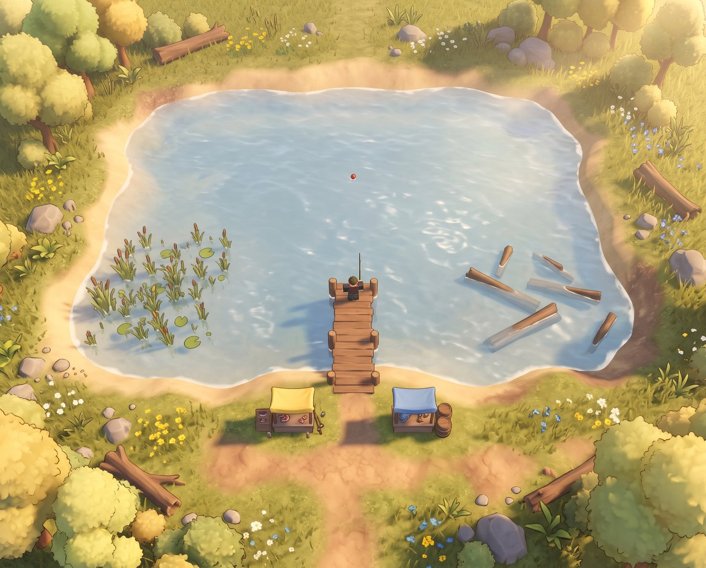
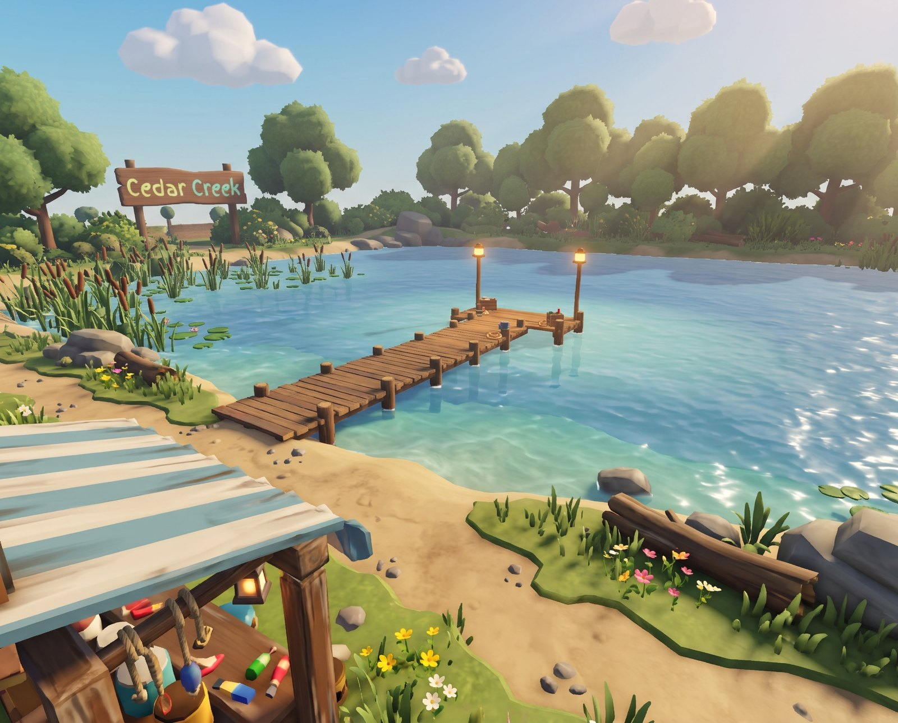
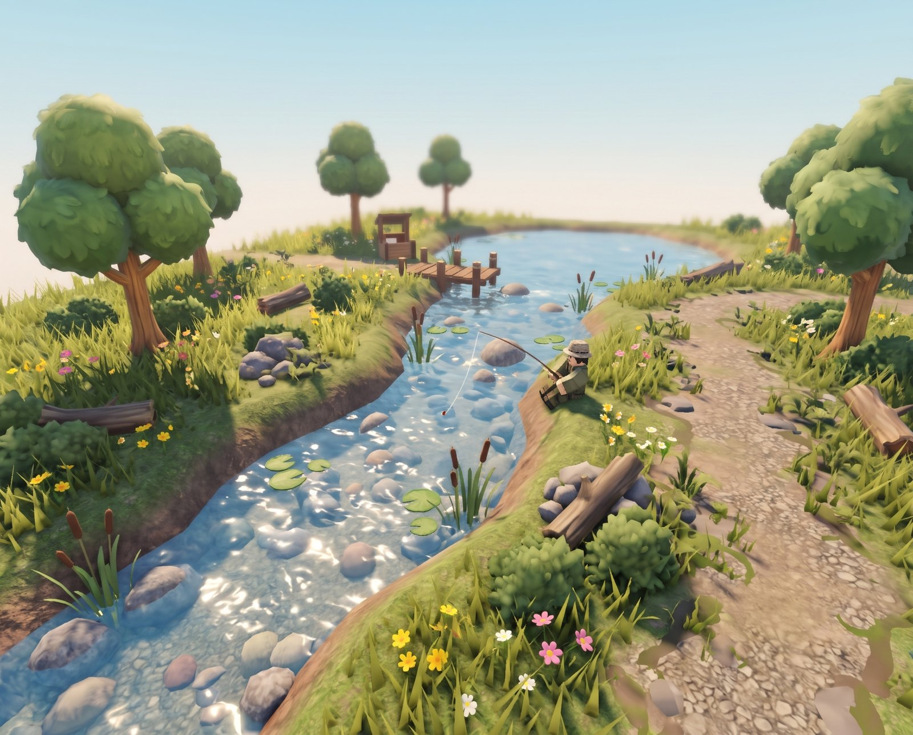
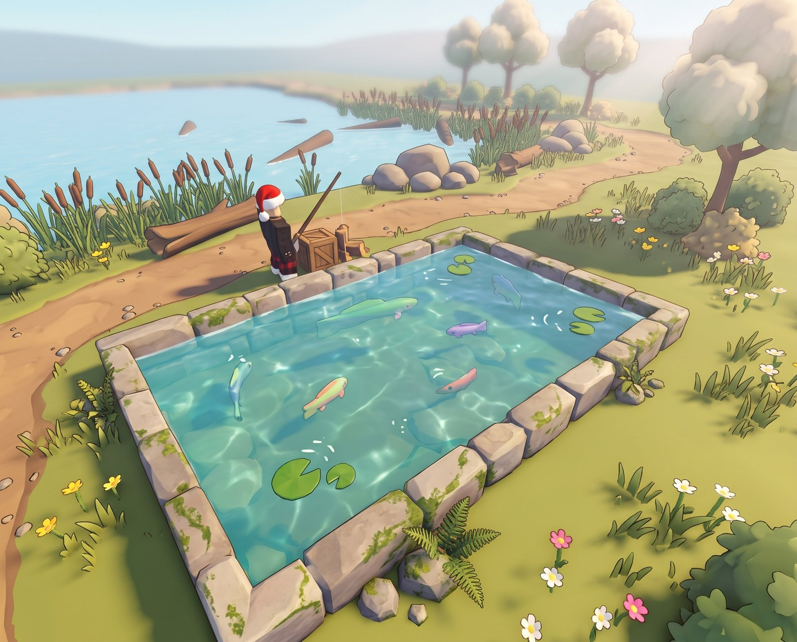
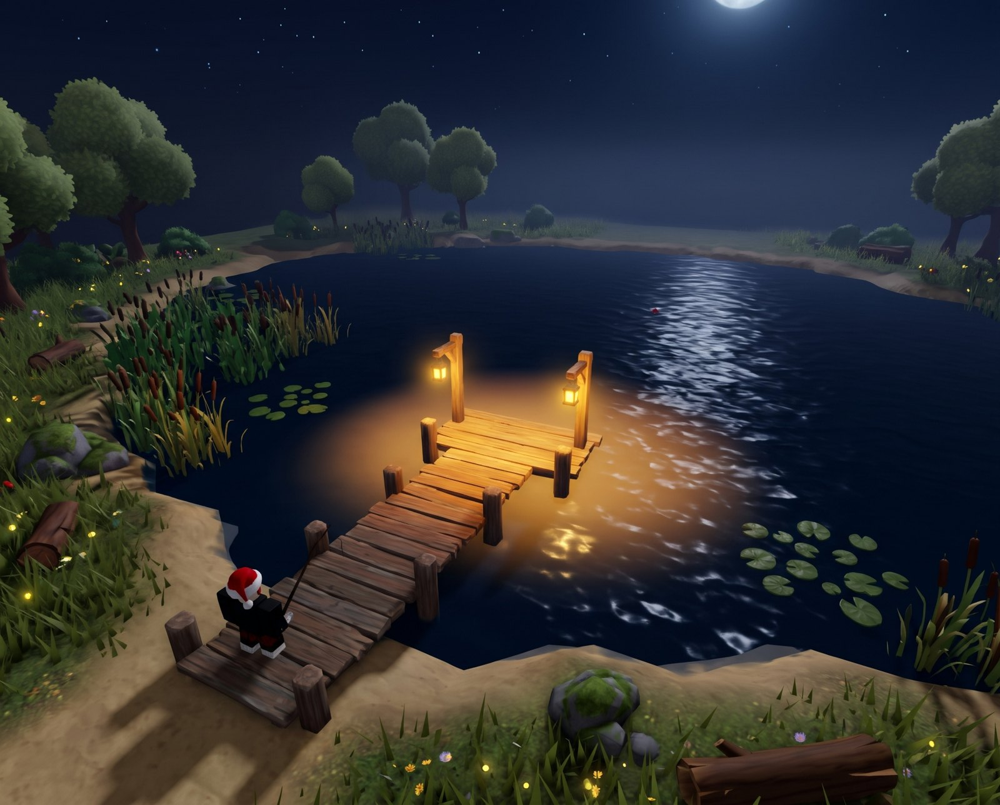

# Storybook

Soft hand-painted textures, like a picture book about a summer by the lake.

| The lake | The dock | Cedar Creek | Your pond | Night |
|---|---|---|---|---|
|  |  |  |  |  |

## What it would take

**In Roblox**
- Painted texture maps on every prop: a MeshPart `TextureID`, or a `SurfaceAppearance` with only a ColorMap, on rounded, softer shapes.
- Ground with a painted feel: custom MaterialVariants for grass, sand and rock (painted tiles) if they apply to terrain, otherwise painted mesh ground near the paths and dock with plain terrain further out. **To check in Studio first:** the Roblox docs don't say whether MaterialVariants reach terrain.
- Soft light: lower contrast, a pastel ColorCorrection, light Atmosphere haze, gentle Bloom. Big rounded clouds from the sky box.

**In our pipeline (the big change)**
- The Blender scripts would need UV unwrapping and a shared painted texture atlas per prop family, instead of flat vertex colours.
- The painting has to come from somewhere. Options: generate tileable painted textures with Gemini's image model or Roblox's `generate_texture`, or Meshy's texturing, then bake them onto our own meshes in Blender. Each texture needs a look pass so the whole world matches.
- Every new prop then costs a model and a texture, not just a model.

## Phone performance risk: medium

Texture memory is the risk. Keep a few shared atlases (512 or 1024 px) for whole prop families rather than one texture per prop. Roblox streams and can drop texture detail on small devices, but a world full of unique textures will look blurry or load slowly on a phone. Light and post effects stay cheap.

## Rough effort: large

About 8 to 12 build sessions before the lake and creek look finished: a texturing step added to the Blender scripts (2), the texture source and a style guide for it (2 to 3), redoing the existing models with textures (2 to 3), terrain look (1 to 2), light (1).

## What changes from today

The house style changes: vertex colours give way to painted textures, and every model script grows a texture step. It would look the most like a picture book, and it is the slowest to build and to add new fish and props to.

## Critic (Gemini 4 Neon)

**Overall 7.9/10**: beauty 8.2, mood 8.7, reads on a phone 6.5, suits kids 8.5. All five images judged together; full verdict in `critic.json`.

> It feels like stepping into a warm, sunny painting of a secret summer fishing spot.

These score the concept images, not the game. The real gray-box lake scored 2.5 to 3 on the same critic, so the scores compare styles with each other, not with today.

What it liked:
- Warm lighting and soft colors create a cozy, welcoming mood, especially in dock.jpg and the lantern-lit night.jpg.
- The wooden docks, signs, and little tackle stalls give the world real charm and personality.
- The night scene shows the style can easily move from calm afternoon fishing to quiet, exciting suspense.
- Soft hand-painted surfaces and rounded shapes feel friendly for ages 8 to 13 without looking too babyish.

Risks it saw:
- The set mixes two different looks, shifting from lineless painted 3D in creek.jpg, dock.jpg, and night.jpg to dark ink outlines in lake.jpg and pond.jpg, and clean ink outlines are tricky to pull off in Roblox on mobile.
- Tiny gameplay details like the bobber and fishing line disappear into bright water sparkles in creek.jpg and dark ripples in night.jpg on a small phone screen.
- Heavy patches of individual grass blades, flowers, and custom painted textures can look cluttered on small screens and slow down older phones in Roblox.
- Players wearing earthy or dark colors blend into the grass banks and shadowed docks unless they have stronger contrast.

Weakest image: pond.jpg
