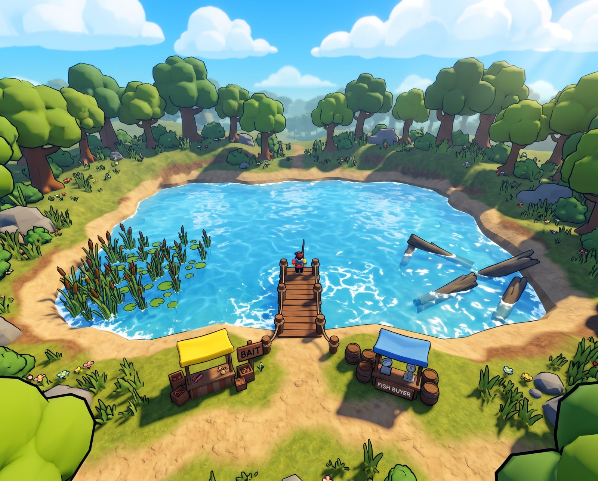
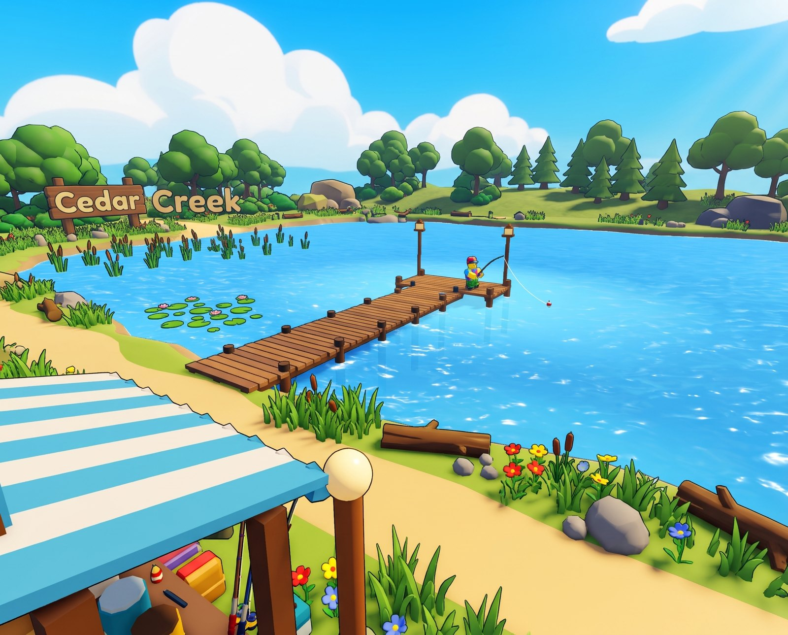
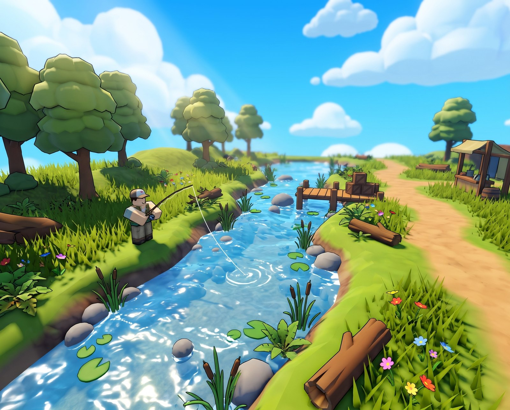
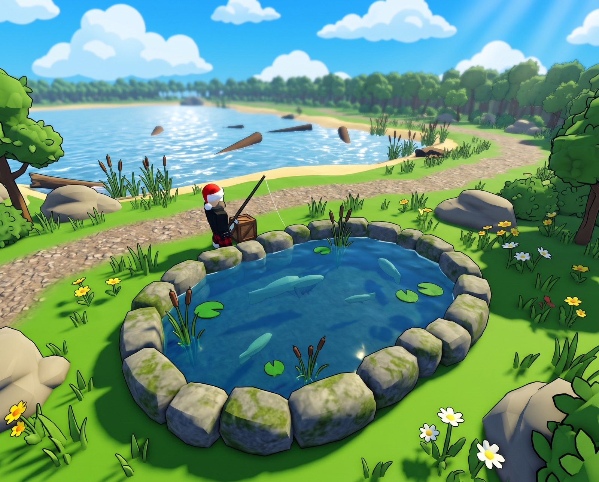
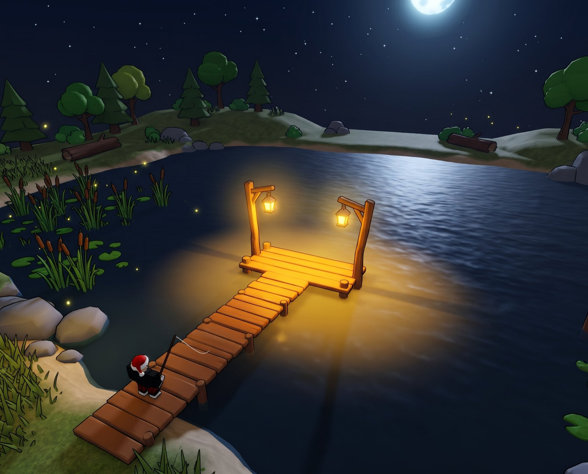

# Bright Toon

Bold flat colours and dark outlines on the props, like a cartoon.

| The lake | The dock | Cedar Creek | Your pond | Night |
|---|---|---|---|---|
|  |  |  |  |  |

## What it would take

**In Roblox**
- Roblox has no custom shaders, so there is no true cel shading. We fake it:
  - flat, saturated vertex colours on SmoothPlastic, high ambient light and soft shadows so surfaces read as flat blocks of colour;
  - outlines built into the models as an "inverted hull": a slightly bigger copy of the mesh with its faces turned inside out and coloured dark, made by the Blender script;
  - Roblox's `Highlight` object for a few special things, like the fish on the line or a rare fish shadow. The docs don't state a limit, but Highlights are meant for a handful of objects, not a whole world.
- Bright midday light, a vivid sky with big clouds, crisp saturated water colour. Terrain can't get outlines, so the ground stays clean flat colour.

**In our pipeline**
- A small addition to `art/scripts/common.py`: an outline-shell step every model can switch on, and a brighter, more saturated palette in `palette.py`.
- Everything else stays: vertex colours, one mesh per model, the same import path.

## Phone performance risk: low to medium

Outline shells roughly double each model's triangles. Our models are small (most under 1,500), so that is fine for props, but keep shells off small scattered things like pebbles and reed clumps. No extra textures. Few Highlights at once.

## Rough effort: medium

About 4 to 6 build sessions: outline step and palette (1 to 2), rebuild and re-upload the existing models (1), lighting and sky (1), terrain colours and water (1 to 2). Each re-upload is a new permanent Roblox asset.

## What changes from today

The models keep the same scripts and gain outlines; the palette gets louder; the light goes bright and flat. It is the most "cartoon", reads very clearly on a small phone, and gives up most of the moody golden-hour and night beauty that `DIRECTION.md` puts first.

## Critic (Gemini 4 Neon)

**Overall 8.0/10**: beauty 7.5, mood 7.0, reads on a phone 8.5, suits kids 9.0. All five images judged together; full verdict in `critic.json`.

> It feels like stepping into a sunny Saturday morning cartoon where every dock, shop, and splash in the water pops right off the screen.

These score the concept images, not the game. The real gray-box lake scored 2.5 to 3 on the same critic, so the scores compare styles with each other, not with today.

What it liked:
- Strong silhouettes and bold color contrast make docks, bait stalls, and signs easy to spot on a small phone screen.
- The playful look fits 8 to 13 year old Roblox players naturally, feeling polished and exciting without looking too babyish.
- night.jpg shows the cartoon style can still deliver a cozy, calm mood when lit by warm lanterns and fireflies.
- The fish shapes inside pond.jpg read clearly under the surface, which helps build anticipation before a bite.

Risks it saw:
- Dark outlines are tricky in real Roblox games because inverted hull meshes double triangle counts for phone GPUs and the built-in Highlight effect is capped at 31 objects.
- Dark outlines on dense grass blades and tiny flowers like in creek.jpg will shimmer and look noisy on a small phone screen.
- Bright white glare and busy ripples on the daytime water in lake.jpg and creek.jpg can hide a small bobber and fishing line during tense catches.
- Mixing realistic textures like the gravel path and mossy stones in pond.jpg with flat toon grass breaks the style if all assets do not follow the same flat shading rule.
- At night, dark outlines and dark outfits blend into the water, so fishing lines and bobbers will need a bright glow to stay readable.

Weakest image: pond.jpg (the realistic gravel path and mossy stone textures clash with the flat cartoon grass and dark outlines)
